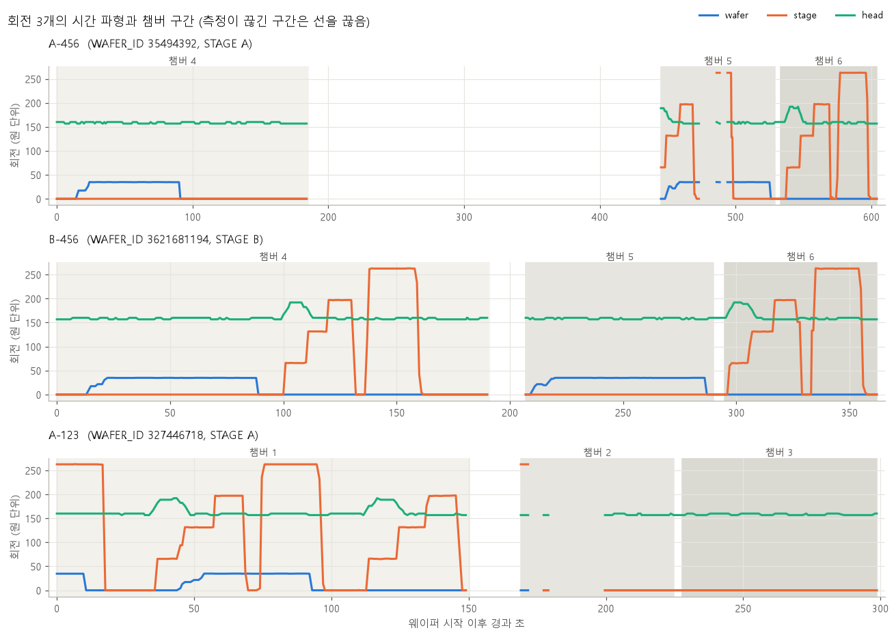
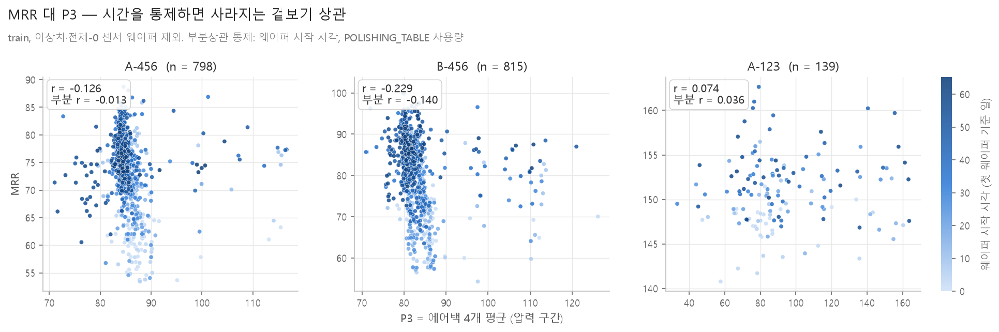
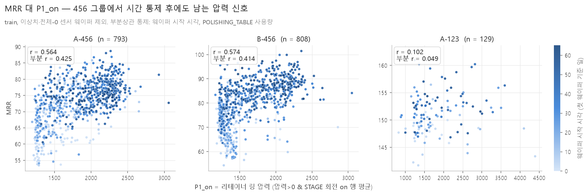
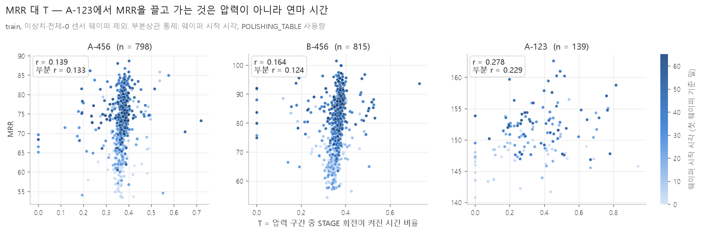

# 물리 파트 결과 정리 — 팀 공유용

- 작성: 김혜연 (2026-09-29)
- 대상: CMP 배경지식 없이 이 결과를 쓰는 팀원
- 숫자의 출처: `docs/reports/repro_김혜연.md`의 "물리 파트 관찰" 절과 `results/diagnostics/`의 진단 파일.
  두 곳 모두 아직 `week4/repro-김혜연` 브랜치에 있다. 각 절 끝에 파일 이름을 적었다.
- 이 문서의 수치는 전부 **train 웨이퍼**에서 나왔다 (4절의 val 확인만 예외). test 라벨은 쓰지 않았다.

---

## 0. 먼저 알아 둘 말

| 용어 | 한 줄 설명 |
|---|---|
| CMP | 웨이퍼 표면을 패드에 눌러 문질러서 평평하게 깎는 공정 |
| MRR | 깎이는 속도 (Material Removal Rate). 우리가 예측할 값 |
| 챔버 | 웨이퍼가 차례로 들르는 연마 칸. 456 그룹은 4→5→6, A-123은 1→2→3 |
| 스테이지 (A/B) | 장비 안의 연마 라인. A-456·A-123은 스테이지 A, B-456은 스테이지 B |
| 상관계수 r | 두 값이 같이 오르내리는 정도. −1~1, 0이면 관계 없음 |
| 부분상관 | 다른 변수(예: 시간)의 영향을 빼고 남은 상관. "시간 때문에 같이 변한 것"을 걸러낸다 |
| 변동계수 (CV) | 표준편차 ÷ 평균. 값이 평균 대비 얼마나 흔들리는지. 0에 가까우면 거의 상수 |
| 통제 변수 | 부분상관에서 영향을 빼는 변수. 이 문서에서는 주로 웨이퍼 시작 시각(`t_start`)과 소모품 사용량 |

---

## 1. 왜 물리 분석을 했나

CMP에는 **Preston 식**이라는 오래된 경험식이 있다.

```
MRR = k · P · V
```

- **P**: 웨이퍼를 누르는 압력
- **V**: 웨이퍼와 패드가 서로 미끄러지는 상대속도
- **k**: 나머지 전부를 담는 계수. 패드·슬러리(연마액)·부품 마모 같은 소모품 상태가 여기에 들어간다

우리 연구의 두 모델이 이 식을 그대로 쓴다 (CLAUDE.md 6.4절).

| 안 | 구조 | k |
|---|---|---|
| B안 | MRR = k·P·V | 상수 (또는 그룹별 상수) |
| C안 | MRR = k(c)·P·V | 소모품 상태 c로 k를 예측하는 모델 |

두 안 모두 **센서에서 P와 V를 제대로 뽑을 수 있어야** 성립한다.
그래서 물리 파트는 "센서 데이터에서 P와 V를 무엇으로 정의할 수 있나"를 확인했다.

> **한 줄 요약**: B안·C안은 MRR = k·P·V 식에 기대므로, 먼저 센서에서 P와 V를 만들 수 있는지 확인해야 했다.

---

## 2. V(회전): 상대속도를 만들 수 없다

센서에는 회전 변수가 3개 있다: `WAFER_ROTATION`(웨이퍼), `STAGE_ROTATION`(패드가 붙은 판), `HEAD_ROTATION`(웨이퍼를 잡는 머리).
교과서대로라면 V는 "stage 회전 − wafer 회전"처럼 두 회전의 차이다.



그림은 그룹별 대표 웨이퍼 1장의 회전 파형이다. 파란선 = wafer, 주황선 = stage, 초록선 = head, 회색 칸 = 챔버.

**2-1. wafer와 stage는 번갈아 켜진다**

| 챔버 | wafer가 켜진 행 | stage가 켜진 행 | 둘 다 켜진 행 |
|---|---|---|---|
| 5 | 87.74% | 0.80% | 0.74% |
| 6 | 4.16% | 71.20% | 2.92% |

- 챔버 5에서는 wafer만, 챔버 6에서는 stage만 돈다. 그림에서도 파란선과 주황선이 거의 겹치지 않는다.
- 웨이퍼 단위로 보면 **86~92%의 웨이퍼에 두 회전이 함께 켜진 순간이 한 번도 없다.**
- 그래서 "stage − wafer"를 계산하면 상대속도가 아니라 "그 순간 켜진 쪽의 값"이 나온다.

**2-2. head 회전은 거의 상수라 k에 흡수한다**

- head는 거의 항상 켜져 있고(92~100%) 값이 160 근처로 안정적이다.
- 웨이퍼 간 변동계수가 0.008~0.035다. 세 그룹 모두 MRR의 변동계수(0.026~0.114)보다 작다.
- head 회전을 압력에 곱해도 MRR 상관이 나아지지 않는다 (A-456 0.303 → 0.286, B-456 0.448 → 0.343).
- 따라서 V = head 회전 ≈ 상수로 보고, **k·V를 한 덩어리 k′로 묶는다.**

**2-3. stage 회전은 속도가 아니라 "지금 연마 중인가" 스위치다**

- stage 회전은 켜지면 거의 같은 값(중앙값 197.11)이다. 속도가 웨이퍼마다 다르지 않다.
- 그래서 stage 회전의 웨이퍼 평균은 "stage가 켜져 있던 시간 비율"과 상관 **0.97**이다 (세 그룹 모두).
- 즉 stage 회전이 알려 주는 정보는 "얼마나 빨리"가 아니라 **"이 순간 패드가 돌며 연마하고 있는가"**다.
- 이 스위치를 4절에서 압력을 평균하는 구간을 고르는 데 쓴다.

> **한 줄 요약**: V는 만들 수 없다. head는 상수라 k에 넣고, stage는 "연마 중" 스위치로 쓴다.

출처: `repro_김혜연.md` 물리 파트 1~3번, 6번 추가 확인 1·2번 / `pv_check.csv`, `pv_check_followup.csv`

---

## 3. P(압력): 에어백은 겉보기 상관이다

압력 센서는 6개다. 그중 핵심 후보는 두 가지였다.

- **에어백 4개** (MAIN_OUTER, CENTER, RIPPLE, EDGE): 웨이퍼 뒷면을 부위별로 누르는 공기 주머니. 평균을 P3라 부른다
- **리테이너 링** (RETAINER_RING): 웨이퍼 둘레를 감싸 미끄러지지 않게 잡는 고리. P1이라 부른다

**3-1. 에어백(P3)은 시간 효과를 빼면 관계가 사라진다**



점 하나가 웨이퍼 하나다. 색이 진할수록 나중에 연마한 웨이퍼다.

| | A-456 | B-456 | A-123 |
|---|---|---|---|
| 상관 r | −0.126 | −0.229 | 0.074 |
| 부분상관 (시간 통제) | −0.013 | −0.140 | 0.036 |

- 점들이 x축(P3)이 아니라 **색으로 갈린다.** 초기 웨이퍼(연한 점)는 아래, 후기 웨이퍼(진한 점)는 위에 있다.
- 즉 MRR을 움직이는 것은 P3가 아니라 시간이다. 웨이퍼 시작 시각 하나만으로 MRR과 상관이 0.51~0.62 나온다.
- 이렇게 **두 값이 모두 시간을 따라 변해서 생긴 상관**을 겉보기 상관이라 한다. A-456에서는 시간을 빼면 −0.013으로 사라진다.
- B-456에는 −0.140이 남지만, 압력이 높을수록 MRR이 낮다는 방향이다. Preston 식과 반대라 압력의 효과로 읽을 수 없다.

**3-2. 리테이너 링(P1)만 관계가 남는다**

| | A-456 | B-456 | A-123 |
|---|---|---|---|
| P1 상관 r | 0.303 | 0.448 | 0.065 |
| P1 부분상관 (시간 통제) | 0.204 | 0.317 | 0.035 |

- 456 두 그룹에서 시간을 빼도 양의 상관이 남는 압력은 P1뿐이다.
- 가압 챔버 압력(P2)도 시간을 빼면 거의 0이 된다 (−0.151 → −0.081, −0.121 → −0.014).

> **한 줄 요약**: 에어백과 MRR의 관계는 시간이 만든 착시다. 시간을 빼도 남는 압력은 리테이너 링뿐이다.

출처: `repro_김혜연.md` 물리 파트 6번 추가 확인 3~5번, 7-1번 / `pv_partial_grid.csv`, `p1_on_corr.csv`

---

## 4. P1_on: 리테이너 링 압력을 "연마 중"일 때만 평균

**4-1. 정의**

```
P1_on = RETAINER_RING_PRESSURE의 평균
        단, (압력 6개 중 하나라도 > 0) 이고 (STAGE_ROTATION > 0) 인 행만
```

2절의 stage 스위치가 켜진 순간, 즉 **실제로 연마하는 순간의 압력만** 평균한다.

**4-2. 왜 평균하는 구간이 결과를 바꾸나 — 숫자 예시**

아래는 이해를 돕기 위해 만든 숫자다. 실제 데이터가 아니다.

어떤 웨이퍼의 10초 기록이 이렇다고 하자.

| 구간 | 길이 | 리테이너 압력 | stage 회전 |
|---|---|---|---|
| 준비 (압력은 걸렸지만 패드는 멈춤) | 6초 | 1400 | 0 |
| 연마 (패드가 돎) | 4초 | 1600 | 200 |

- 압력 > 0인 행 전체 평균 (P1): (6 × 1400 + 4 × 1600) ÷ 10 = **1480**
- stage가 켜진 행만 평균 (P1_on): **1600**

실제로 웨이퍼를 깎는 것은 연마 중 4초의 압력 1600이다.
P1은 여기에 "준비 시간이 몇 초였나"가 섞인다. 준비 시간이 웨이퍼마다 다르면, 같은 연마 압력이라도 P1 값이 달라진다.
P1_on은 그 잡음을 걷어 낸다.

**4-3. 결과: 구간만 좁혔는데 관계가 크게 강해졌다**



| | A-456 | B-456 | A-123 |
|---|---|---|---|
| P1 부분상관 (압력 > 0 구간) | 0.204 | 0.317 | 0.035 |
| **P1_on 부분상관** (압력 > 0 이고 stage on) | **0.425** | **0.414** | 0.049 |
| P1_on 상관 r | 0.564 | 0.574 | 0.102 |

- 456 두 그룹 모두 점이 왼쪽 아래에서 오른쪽 위로 올라간다.
- A-123은 여전히 관계가 없다 (5절).

**4-4. Di 피처 `mean_RETAINER_s1`과의 비교**

Di et al.의 125개 피처(R 세트)에도 리테이너 링 평균이 있다. 차이는 평균하는 구간이다.

| | 평균 구간 | 피처 선택 결과 |
|---|---|---|
| `mean_RETAINER_s1` (Di) | 챔버 4(또는 1)의 **모든 행**. 압력 0인 행, stage가 멈춘 행 포함 | 20회 중 **0회** 선택 (세 그룹 모두) |
| P1_on (우리) | 압력 > 0 이고 stage on인 행 | — (R 세트에 없음) |

- 피처 선택은 Monte Carlo CV 20회(데이터를 무작위로 80/20으로 나눠 20번 반복)마다 두 기준(단순회귀 t-검정, 나무 모델의 순열 중요도)을 모두 통과한 피처를 세는 방식이다.
- 같은 센서, 같은 챔버인데 **평균 구간이 넓으면 한 번도 뽑히지 않는다.** 4-2의 예시와 같은 이유다.
- 참고로 같은 변수의 표준편차·적분 피처(`std_RETAINER_s1`, `auc_RETAINER_s1`)는 456 그룹에서 11~20회 뽑혔다. 리테이너 링 신호 자체는 R 세트에서도 쓰이고 있다.

**4-5. 강건성: 다른 설명을 막아도 남는가**

"소모품이 닳으면서 압력과 MRR이 같이 변했을 뿐"일 수도 있다. 통제를 하나씩 늘리고, val 웨이퍼에서도 다시 봤다.

| 확인 | 통제 변수 | A-456 | B-456 |
|---|---|---|---|
| 상관 r (통제 없음) | — | 0.564 | 0.574 |
| 1 기본 | 시작 시각 + 폴리싱 테이블 사용량 | 0.425 | 0.414 |
| 2 소모품 통제 | 시작 시각 + 소모품 6개 사용량 | 0.332 | 0.338 |
| 3 + 교체 후 누적량 | 2 + 부품 교체 이후 누적 사용량 5개 | 0.312 | 0.346 |
| 4 곡선 시간 | 2 + 시작 시각의 2차·3차 항 | 0.307 | 0.321 |
| **val** 상관 r | — | 0.482 | 0.572 |
| **val** 1 기본 | 1과 같음 | 0.341 | 0.367 |
| **val** 2 소모품 통제 | 2와 같음 | **0.264** | **0.261** |

- 소모품 6개를 통제하면 0.42 → 0.33 정도로 내려간다. 이 하락분이 "소모품과 겹치는 부분"이다.
- 통제를 더 붙여도(3·4) 추가 하락은 0.03 이하다. **남은 0.3은 시간·소모품으로 설명되지 않는다.**
- "곡선 시간"은 시간 추세가 직선이 아니라 휘어 있을 가능성까지 막아 본 것이다.
- val은 train에서 찾은 정의를 처음 보는 웨이퍼에 적용한 것이라 조금 낮은 것이 정상이다.
  val 표본(약 180장)에서 상관의 표준오차는 약 0.075라, 차이 0.07은 우연 범위 안이다.

> **한 줄 요약**: 리테이너 링 압력을 "연마 중"인 순간만 평균하면(P1_on) 456 그룹에서 시간·소모품을 통제하고 val에서 다시 봐도 관계가 남는다.

출처: `repro_김혜연.md` 물리 파트 7-2번, 8번, 9번 / `p1_on_corr.csv`, `pv_partial_consumables.csv`, `p1_on_val.csv`, `R_feature_votes.csv`

---

## 5. A-123은 다르다

**5-1. 압력과는 관계가 없고, 연마 시간과만 약하게 관계가 있다**

T = 연마 구간 중 stage가 켜져 있던 시간의 비율 (2-3의 스위치가 켜진 비율).



| A-123 | 상관 r | 부분상관 (시간 통제) | 부분상관 (소모품 통제) |
|---|---|---|---|
| P1_on | 0.102 | 0.049 | 0.056 |
| P1 | 0.065 | 0.035 | 0.045 |
| **T** | 0.278 | **0.229** | **0.258** |

- 456 그룹은 T가 0.35~0.40에 몰려 있어 (거의 고정된 레시피) 쓸모가 없다.
- A-123만 T가 0.1~0.9로 넓게 퍼져 있고, 시간을 통제해도 0.23이 남는다.
- 다만 약한 관계다. A-123의 MRR 변동계수는 0.026으로, 애초에 MRR이 거의 변하지 않는 그룹이다.
- Di 피처 선택에서도 A-123은 압력 피처 36개와 회전 피처 6개를 **하나도 고르지 않았다.** 물리 관찰과 같은 결론이 독립적으로 나왔다.

**5-2. 전체-0 센서 웨이퍼**

- A-123 웨이퍼 일부는 압력·유량·회전 센서 중 하나 이상이 **웨이퍼 전체에서 0**이다. 값이 비어 있는 대신 0으로 기록된 것으로 보인다.
- train 368장 중 228장(62%), val 67장 중 40장, test 73장 중 46장이다. 456 그룹에는 없다.
- 이 때문에 val에서 A-123의 P1_on을 확인할 수 있는 웨이퍼가 23장뿐이라, val 결과(상관 95% 신뢰구간 −0.098~0.652)로는 판단하지 않았다.
  신뢰구간은 "진짜 상관이 이 범위 어딘가에 있다"는 뜻이고, 0을 포함하면 관계가 있다고 말할 수 없다.

**5-3. 처리 방식 비교 (결정은 팀 회의)**

A-123만 대상으로, Di 피처(R 세트)와 같은 선택 절차·같은 분할 20회로 네 방식을 비교했다.
값은 MSE(오차 제곱의 평균, 낮을수록 좋음). 공정하게 비교하려고 **네 방식 모두 결측 없는 같은 평가 웨이퍼**에서 쟀다.

| 방식 | LR (선형회귀) | tree bagging (나무 모델 여러 개 평균) |
|---|---|---|
| 1 현재 (표시만 하고 그대로 둠) | 6.17 ± 1.59 | 5.52 ± 1.48 |
| 2 전체-0 웨이퍼 제외 | 7.75 ± 2.06 | 5.76 ± 1.40 |
| 3 결측 없는 피처만 사용 | 6.05 ± 1.74 | 5.51 ± 1.39 |
| 4 결측 표시 피처 추가 | 6.19 ± 1.68 | 5.54 ± 1.51 |

- **방식 1·3·4는 사실상 같다.** 차이(−0.12~+0.02)가 분할 간 흔들림(1.4~1.7)보다 훨씬 작다.
- **방식 2(제외)는 오히려 나쁘다.** 학습 웨이퍼가 290장에서 109장으로 줄기 때문으로 보인다.
- 어느 방식이든 전체-0 웨이퍼 자체의 예측 오차가 더 크다. 전체-0 웨이퍼까지 넣어 평가하면 MSE가 1.4~1.6 커지고, 처리 방식으로 줄어들지 않는다.

> **한 줄 요약**: A-123은 압력과 무관하고 연마 시간 비율(T)과만 약하게 관계가 있으며, 전체-0 웨이퍼는 빼기보다 그대로 두는 쪽이 낫다.

출처: `repro_김혜연.md` 물리 파트 7-3번, 8번, 9번, 10번, "R 피처 선택 적용" 절 / `pv_partial_consumables.csv`, `p1_on_val.csv`, `allzero_handling.csv`

---

## 6. 결론: 물리식이 설명하는 몫은 작다

**6-1. 우리 데이터에서 남는 식**

| 그룹 | 식 | 뜻 |
|---|---|---|
| A-456, B-456 | MRR ≈ k′ · P1_on | V는 상수라 k에 흡수 (k′ = k·V) |
| A-123 | MRR ≈ k′ · T | 압력은 설명력 없음, 연마 시간 비율만 남음 |

**6-2. 그래도 대부분은 k가 떠안는다**

- 부분상관을 제곱하면 "통제 변수로 설명하고 남은 변동 중 이 변수가 설명하는 비율"이 된다.
- P1_on의 소모품 통제 후 부분상관은 0.31~0.35 (4-5 표의 2~4번). 제곱하면 **0.09~0.12, 즉 남은 변동의 약 10%**다.
- 나머지 약 90%는 P1_on으로 설명되지 않는다. 식 안에서는 **k(소모품 상태 등)가 떠안는다.**
- 참고로 Di 피처로 만든 예측 모델에서도 힘은 라벨 쪽에서 나온다. 과거 웨이퍼의 MRR로 만든 피처 21개가 세 그룹 모두 20회 중 20회 선택됐다.
  직전 웨이퍼의 MRR을 그대로 답으로 쓰는 **지속 모델**(학습 없는 기준선)의 MSE가 A-456 12.41 / B-456 18.24 / A-123 9.79이고,
  tree bagging이 6.80 / 10.41 / 7.00이다.

**6-3. 그래서 C안의 역할을 바꾼다**

- P1_on 하나로 정확도를 크게 올리기는 어렵다. C안(MRR = k(c)·P1_on)이 A안보다 정확할 것이라고 기대하지 않는다.
- 대신 C안은 **k를 따로 떼어 볼 수 있다**는 장점이 있다.
  - **k 해석**: 소모품 상태에 따라 k가 어떻게 변하는지 보여 준다.
  - **샘플링 트리거**: k가 불확실해지거나 소모품 상태가 많이 변했을 때 실측할 웨이퍼로 고른다 (CLAUDE.md 6.5절 "k 상태" 정책).

> **한 줄 요약**: 456은 MRR ≈ k′·P1_on, A-123은 MRR ≈ k′·T이지만 P1_on도 남은 변동의 약 10%만 설명하므로, C안은 정확도보다 k 해석과 샘플링 트리거에 쓴다.

출처: `repro_김혜연.md` 물리 파트 8번, "R 피처 선택 적용"·"최종 결과표" 절 / `pv_partial_consumables.csv`, `R_feature_votes.csv`

---

## 7. 아직 모르는 것 (교수님 자문 대기)

1. **리테이너 링이 왜 MRR과 관계되나.**
   리테이너 링은 웨이퍼를 누르는 부품이 아니라 둘레를 잡는 부품이다. 웨이퍼를 직접 누르는 에어백은 관계가 없는데 리테이너 링만 남는 공정상 이유를 모른다.
2. **run-to-run 제어로 생긴 관계일 가능성.**
   run-to-run 제어는 직전 웨이퍼의 결과를 보고 다음 웨이퍼의 공정 조건을 자동으로 고치는 방식이다.
   장비가 "MRR이 떨어지면 리테이너 압력을 올린다"는 식으로 움직였다면, 압력이 MRR을 만든 게 아니라 MRR이 압력을 만든 것일 수 있다.
   그렇다면 P1_on은 원인이 아니라 장비의 판단을 읽는 피처가 된다. 예측에는 쓸 수 있지만 물리적 해석은 달라진다.
3. **전체-0 센서 웨이퍼의 정체.**
   A-123의 62%에서 센서가 웨이퍼 전체 0이다. 센서 기록 누락인지, 실제로 다른 방식으로 연마한 웨이퍼인지 모른다.
   어느 쪽이냐에 따라 5-3의 처리 방식 선택이 달라질 수 있다.

> **한 줄 요약**: 리테이너 링 관계의 원인, 장비 자동 제어의 영향, 전체-0 웨이퍼의 정체는 자문 후에 정한다.
