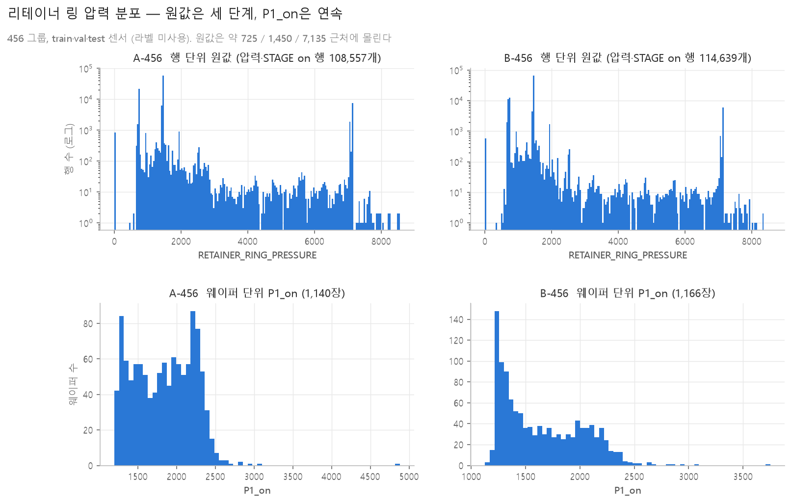
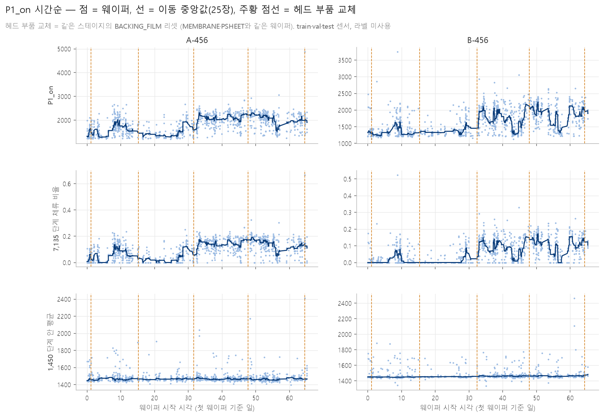
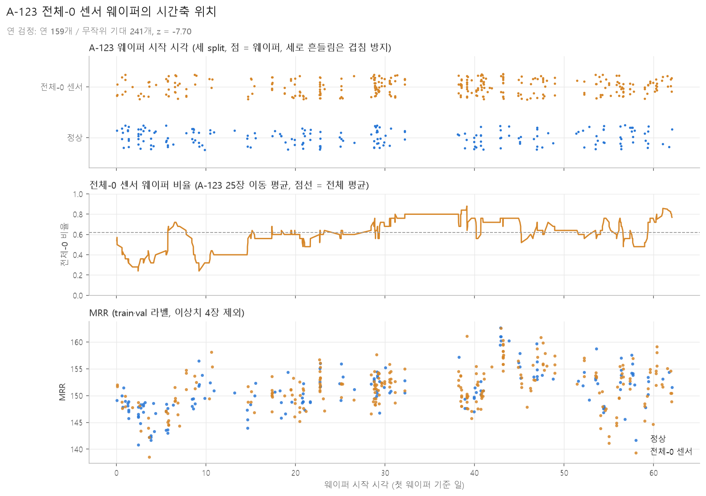
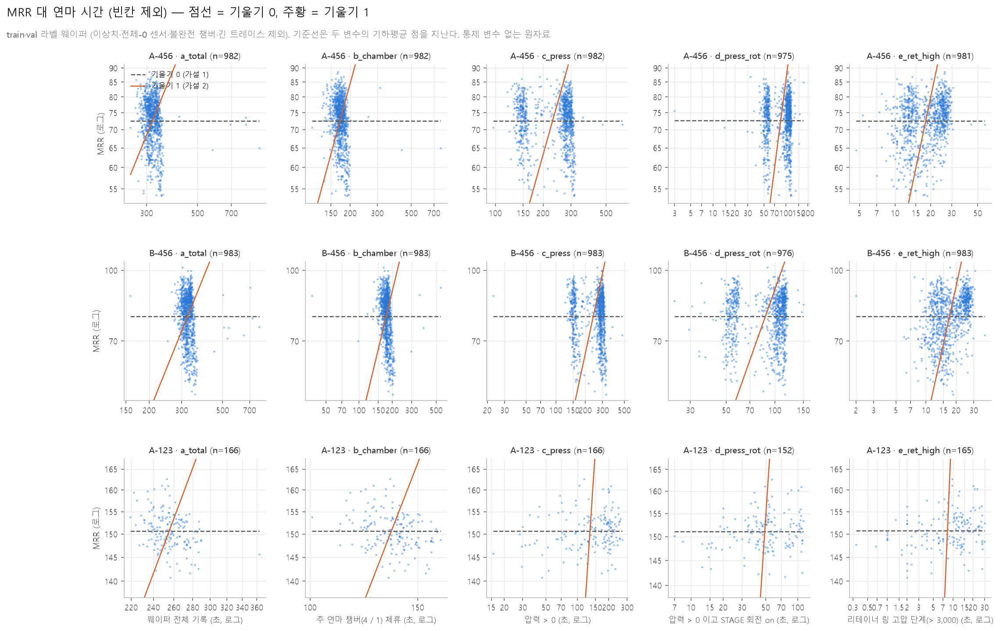
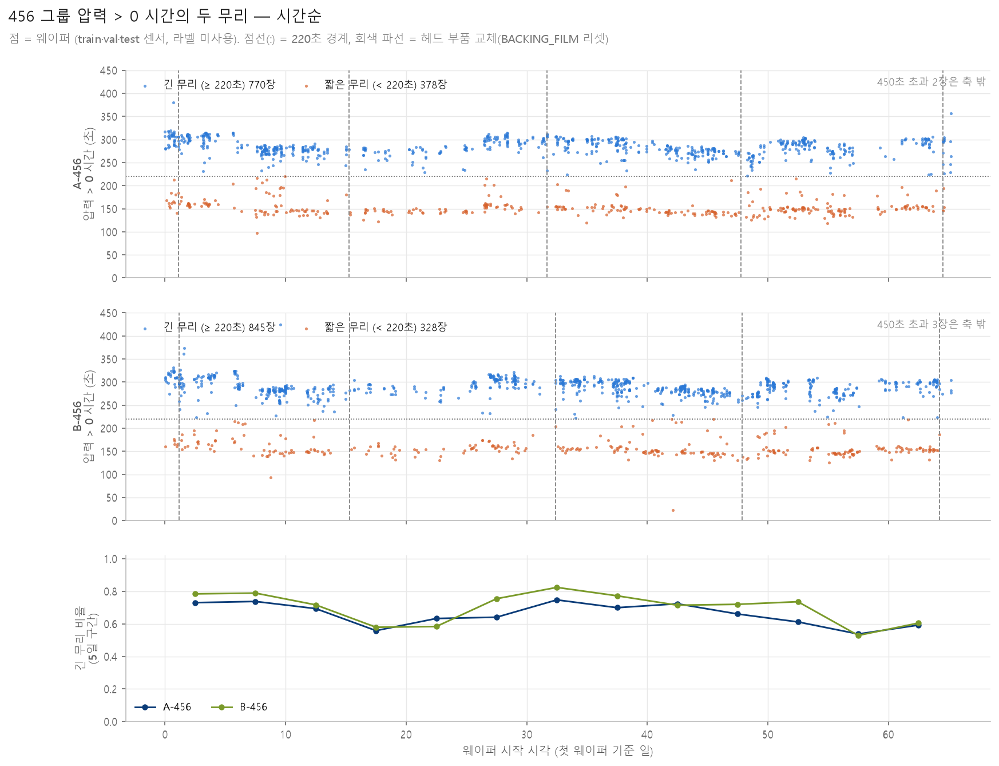

# 재현 작업 기록 — 김혜연

- 브랜치: `week4/repro-김혜연`
- 이 문서는 재현(Di 원문) 작업 중 관찰한 것을 쌓아 두는 개인 기록이다. 팀 규칙은 [CLAUDE.md](../../CLAUDE.md)가 단일 기준이고, 여기 내용으로 규칙을 바꾸지 않는다.

## 물리 파트 관찰

2026-09-26 확인. 입력은 `data/raw` 센서(train·val·test)와 `data/processed/wafer_table.csv`다. 라벨은 쓰지 않았다.

그림:
- `docs/reports/figs/김혜연_rotation_by_chamber.png` — 회전 3개의 시간 파형, 그룹별 대표 웨이퍼 1장씩, 챔버 구간 음영
- `docs/reports/figs/김혜연_pressure_by_chamber.png` — 같은 웨이퍼의 압력 6개 (y축 symlog)

대표 웨이퍼는 train에서 플래그가 하나도 없는 웨이퍼 중 행 수가 그룹 중앙값에 가장 가까운 1장이다 (A-456 `35494392`/A, B-456 `3621681194`/B, A-123 `327446718`/A).

### 1. 챔버별 회전 변수 (전체 센서 행 기준)

| 챔버 | wafer 비0 | stage 비0 | head 비0 | wafer·stage 동시 비0 |
|---|---|---|---|---|
| 1 | 16.65% | 14.50% | 99.82% | 2.86% |
| 2 | 17.18% | 14.41% | 99.92% | 3.16% |
| 3 | 15.94% | 15.05% | 100.00% | 3.06% |
| 4 | 38.05% | 29.74% | 99.84% | 0.34% |
| 5 | **87.74%** | 0.80% | 99.99% | 0.74% |
| 6 | 4.16% | **71.20%** | 92.41% | 2.92% |

0이 아닐 때의 중앙값은 챔버와 거의 무관하다: wafer 34.65, stage 197.11, head 160 (챔버 5만 156.8). 설정값 몇 개를 오가는 이산 신호로 보인다.

- `HEAD_ROTATION`은 거의 항상 켜져 있고(92~100%) 값이 안정적이다.
- `WAFER_ROTATION`과 `STAGE_ROTATION`은 **교대로** 켜진다. 챔버 5는 wafer만, 챔버 6은 stage만 켜진다. 파형에서도 두 선이 겹치지 않는다.

### 2. 웨이퍼 기준 동시 비0

행 기준으로는 전체 1.30%(챔버별 0.34~3.16%)지만, 더 중요한 것은 웨이퍼 기준이다.

| 그룹 | 동시 비0 행이 **0개**인 웨이퍼 | 10개 미만인 웨이퍼 | 웨이퍼당 동시 비0 행 중앙값 |
|---|---|---|---|
| A-456 | 91.1% | 91.7% | 0 |
| B-456 | 92.2% | 93.1% | 0 |
| A-123 | 86.4% | 87.6% | 0 |

**웨이퍼의 86~92%는 두 회전이 함께 켜진 행이 하나도 없다.** 3사분위수도 0이다.

### 3. 8절 V 후보 판정

| 후보 | 정의 | 판정 |
|---|---|---|
| V1 | `STAGE_ROTATION − WAFER_ROTATION` (Yu 2019) | **행 단위로는 사실상 불가.** 웨이퍼의 86~92%에 두 값이 함께 켜진 행이 없어, 거의 모든 행에서 한쪽이 0인 채 빼기가 된다. 결과는 "그 시점에 켜진 쪽 값"이지 상대속도가 아니다 |
| V2 | `HEAD − (STAGE − WAFER)`, 웨이퍼별 중앙값 (Deivendran Eq. 8) | **계산은 되지만 의미가 흔들린다.** 두 회전이 함께 켜진 행만 보면 68.2%가 음수, 중앙값 −19.04. 전체 행으로 계산하면 중앙값 160.0으로 사실상 `HEAD` 값만 남는다 |
| V3 | `STAGE_ROTATION` 단독 (우리 제안) | **계산은 되지만 대부분 0이다.** 챔버 1~5의 중앙값이 0이고 챔버 6만 131.1. 웨이퍼 평균은 "챔버 6에서 얼마나 돌았나"를 재는 값이 된다 |

### 4. 추천 방향 (결정은 물리 담당·팀 회의)

1. **`HEAD_ROTATION` 기반 V를 후보에 추가한다.** 유일하게 항상 켜져 있고 값이 안정적이다. 예: 연마 구간(압력 > 0)의 head 평균.
2. **챔버별로 켜진 회전을 따로 쓰는 안**도 후보로 둔다 (챔버 5는 wafer, 챔버 6은 stage). 챔버마다 구동계가 다르게 도는 것으로 보이므로, 하나의 V로 뭉치는 것보다 물리적으로 맞을 수 있다.
3. V1·V2를 굳이 쓴다면 **행 단위가 아니라 "켜진 구간의 대푯값끼리" 계산**해야 한다. 예: 웨이퍼 안에서 wafer 회전이 켜진 구간의 평균과 stage 회전이 켜진 구간의 평균을 각각 구한 뒤 빼기.
4. 어느 안이든 **연마 구간(압력 > 0) 안에서만** 계산하는 편이 낫다. 압력이 0인 구간이 그룹마다 18~50%씩 섞여 있다 (아래 5번).

### 5. 압력이 켜지는 챔버 (A-123의 주 연마 챔버 확인)

결과 파일: `results/diagnostics/2026-09-26_김혜연_pressure_by_chamber.csv` (+ `.yaml`), 스크립트 `src/pressure_profile.py`.

0이 아닌 행의 비율(%), 전체-0 센서 웨이퍼(5.4절)를 뺀 값:

| 그룹 | 챔버 | RETAINER | MAIN_OUTER |
|---|---|---|---|
| A-123 | 1 | **62.66** | 57.17 |
| A-123 | 2 | 51.76 | 47.09 |
| A-123 | 3 | 45.51 | 41.18 |
| A-456 | 4 | **82.02** | 74.13 |
| A-456 | 5 | 61.78 | 59.49 |
| A-456 | 6 | 55.46 | 47.89 |
| B-456 | 4 | **81.48** | 73.88 |
| B-456 | 5 | 65.70 | 63.30 |
| B-456 | 6 | 67.22 | 59.71 |

전체-0 센서 웨이퍼를 포함하면 A-123 수치만 18~25%로 내려간다. 그 웨이퍼들이 A-123의 62%(train 228/368)를 차지하기 때문이다.

웨이퍼마다 "압력이 켜진 행이 가장 많은 챔버"를 세면 (전체-0 센서 웨이퍼 제외):

| 그룹 | 챔버 1 | 챔버 2 | 챔버 3 | 챔버 4 | 챔버 5 | 챔버 6 |
|---|---|---|---|---|---|---|
| A-123 (194장) | **90.2%** | 1.0% | 8.8% | — | — | — |
| A-456 (1,148장) | — | — | — | **99.8%** | 0.1% | 0.1% |
| B-456 (1,173장) | — | — | — | **99.7%** | 0.2% | 0.2% |

**결론: A-123의 주 연마도 챔버 1이다.** 456 그룹의 챔버 4와 같은 위치다. 5.3절의 구간 분할(s1 = 챔버 4 또는 1)은 그대로 타당하다.

다만 A-123은 456 그룹보다 편차가 크다. 정상 웨이퍼 중에서도 8.8%는 챔버 3이 주 챔버이고, 챔버 1에서 압력이 한 행도 켜지지 않은 웨이퍼가 2.1%다 (챔버 2는 27.8%, 챔버 3은 36.6%). 위 그림의 A-123 대표 웨이퍼가 그 소수 사례에 해당한다. A-123만 별도 모델을 쓰는 안(4주차 보고서 4절 2번)을 뒷받침한다.

### 6. P·V 후보의 그룹 내 변동계수와 MRR 상관

결과 파일: `results/diagnostics/2026-09-26_김혜연_pv_check.csv` (+ `.yaml`), 스크립트 `src/pv_check.py`.

**대상과 계산 방식**
- train 웨이퍼, 이상치 4장 제외 (1,977장). MRR은 상관 계산에만 쓰고 피처로 쓰지 않았다.
- **모든 후보 값은 원본 센서에서 웨이퍼 단위로 새로 계산했다.** 집계표(`wafer_table.csv`)에서 가져온 것은 `group`, `MRR`, `n_allzero_sensors`뿐이다. 집계표의 `mean_RETAINER_s1` 같은 구간 통계는 구간이 챔버 기준이라 "압력이 걸린 구간"과 다르므로 쓰지 않았다.
- 집계 두 가지: `whole`(웨이퍼 전 행 평균), `polish`(압력 6개 중 하나라도 > 0인 행만 평균).
- 부분집합 두 가지: `all`(이상치 제외 train), `clean`(전체-0 센서 웨이퍼까지 제외). A-456·B-456은 전체-0 센서 웨이퍼가 없어 둘이 같고, A-123만 364장 → 139장으로 줄어든다.
- V5는 챔버별로 켜진 회전 한 개를 쓴다: 챔버 6은 `STAGE_ROTATION`, 나머지는 `WAFER_ROTATION` (1번 표의 비0 비율에서 더 높은 쪽).
- P×V는 행 단위로 곱한 뒤 웨이퍼 평균을 냈다 (∫P·V dt의 이산 근사).

**변동계수 (clean, polish 기준)**

| 후보 | A-456 | B-456 | A-123 |
|---|---|---|---|
| **MRR (비교 기준)** | **0.091** | **0.114** | **0.026** |
| P1 리테이너 | 0.044 | 0.054 | 0.163 |
| P2 가압 챔버 | 0.053 | 0.072 | 0.345 |
| P3 에어백 4개 | 0.055 | 0.076 | 0.310 |
| V4 head 회전 | 0.020 | 0.035 | 0.008 |
| V1 stage−wafer | 0.200 | 0.198 | 0.870 |
| V3 stage 단독 | 0.147 | 0.152 | 0.646 |
| V5 챔버별 켜진 회전 | 0.405 | 0.396 | 0.570 |
| P1×V1 | 0.402 | 0.452 | 1.026 |
| P1×V3 | 0.329 | 0.354 | 0.819 |

**MRR 상관 (clean, polish 기준, 절댓값 상위)**

| 그룹 | 1위 | 2위 | 3위 |
|---|---|---|---|
| A-456 | P1×V3 0.522 | P1×V1 0.516 | P1×V2 −0.448 |
| B-456 | P1×V3 0.530 | P1×V1 0.529 | P1 0.448 |
| A-123 | P1×V1 0.253 | V1 0.245 | V2 −0.243 |

`whole` 집계는 모든 후보에서 상관이 낮아진다 (최대 0.45). 압력이 걸리지 않은 행이 섞이기 때문이다. A-123은 `all`과 `clean`의 상관이 거의 같아(0.248 → 0.253), 전체-0 센서 웨이퍼를 빼는 것만으로는 설명력이 살아나지 않는다.

**판단 (3줄 요약)**

1. **456 그룹에서 P·V는 MRR과 중간 정도만 맞는다.** 가장 좋은 조합(P1×V3, P1×V1)이 상관 0.52~0.53, 즉 MRR 분산의 약 27%만 설명한다. 나머지 73%는 k(소모품 상태 등)가 져야 한다 → C안(k를 모델로 학습)이 B안(k 상수)보다 필요하다는 근거다.
2. **변동의 크기는 반대 방향으로 어긋난다.** P 단독은 MRR보다 덜 변하고(CV 0.04~0.08 대 0.09~0.11), P·V는 훨씬 많이 변한다(CV 0.33~0.45). 즉 P·V를 그대로 쓰면 MRR보다 과하게 출렁이므로, k가 그 출렁임을 상쇄해 주어야 한다.
3. **A-123에서는 P·V가 MRR을 거의 설명하지 못한다** (최대 상관 0.25, MRR CV는 0.026으로 애초에 변동이 작다). A-123은 물리식 기반 안(B·C)보다 통계 모델이 나을 수 있고, 최소한 별도 취급이 필요하다.

**V 후보에 대한 함의**
- V4(head)는 CV가 0.008~0.035로 사실상 상수다. 분모로 쓰면 k가 P·V 변동을 그대로 떠안는다. 반대로 말하면, V를 상수로 두는 단순화가 456 그룹에서 큰 손해가 아니다.
- V1·V3·V5는 CV가 크지만(0.15~0.87) 그 변동의 상당 부분이 "켜진 행의 비율" 차이에서 온다. 단독 상관은 0.13~0.25로 낮고, P1과 곱했을 때만 상관이 올라간다.
- P는 P1(리테이너)이 가장 낫다. P2·P3는 456 그룹에서 MRR과 음의 상관(−0.12~−0.23)이 나온다.

#### 추가 확인 (2026-09-26)

결과 파일: `results/diagnostics/2026-09-26_김혜연_pv_check_followup.csv` (+ `.yaml`), 스크립트 `src/pv_check_followup.py`.
대상은 clean(train, 이상치·전체-0 센서 제외) 1,752장, 압력 구간 평균 기준이다.

**1. P1 단독 / V4 단독 / P1×V4 의 MRR 상관**

| 후보 | A-456 | B-456 | A-123 |
|---|---|---|---|
| P1 단독 | 0.303 | 0.448 | 0.065 |
| V4 단독 | 0.042 | −0.050 | 0.088 |
| P1×V4 | 0.286 | 0.343 | 0.066 |

**V4를 곱해도 P1 단독보다 나아지지 않는다.** 오히려 조금 낮아진다 (0.303 → 0.286, 0.448 → 0.343). V4가 사실상 상수라 정보가 없고, 곱하면 잡음만 더해진다. 앞의 6번에서 P1×V1·P1×V3가 0.52~0.53으로 높았던 것은 **V4가 아니라 V1·V3가 가진 무언가** 덕분이다. 그 정체가 2번이다.

**2. V3는 속도가 아니라 '켜진 시간'을 재고 있다**

| 상관 | A-456 | B-456 | A-123 |
|---|---|---|---|
| V3 vs 압력 구간 중 STAGE가 켜진 시간 비율 | **0.973** | **0.972** | **0.969** |
| 켜진 시간 비율 vs MRR | 0.139 | 0.164 | 0.278 |

V3(웨이퍼 평균)와 "켜진 시간 비율"의 상관이 세 그룹 모두 0.97이다. **V3의 웨이퍼별 차이는 회전 속도 차이가 아니라 STAGE가 켜져 있던 시간 비율 차이다.** 켜졌을 때의 값이 197.11로 거의 고정이기 때문이다(1번 표). V1도 STAGE에서 오는 값이라 같은 성질을 공유한다.

따라서 P1×V3·P1×V1의 상관 0.52~0.53은 "압력 × 속도"가 아니라 **"압력 × 연마에 쓴 시간 비율"**에 가깝다. Preston 식의 V로 해석하면 안 된다.

**3. 시간 추세를 뺀 부분상관** (통제 변수: `t_start`, `start_POLISH_TABLE_w`)

| 후보 | A-456 원래 → 부분 | B-456 원래 → 부분 | A-123 원래 → 부분 |
|---|---|---|---|
| P1×V3 | 0.522 → **0.389** | 0.530 → **0.376** | 0.236 → 0.166 |
| P2 | −0.151 → −0.081 | −0.121 → −0.014 | 0.030 → 0.032 |
| P3 | −0.126 → −0.013 | −0.228 → −0.140 | 0.074 → 0.036 |

통제 변수 자체와 MRR의 상관: `t_start` 0.509 / 0.620 / 0.549, `start_POLISH_TABLE_w` −0.014 / −0.122 / 0.101.

**시간 추세가 크다.** 웨이퍼 시작 시각만으로 MRR과 0.51~0.62의 상관이 나온다. P1×V3의 상관은 시간 영향을 빼면 0.52~0.53에서 0.38~0.39로 떨어진다. 즉 **P·V와 MRR 상관의 약 4분의 1은 "둘 다 시간에 따라 변해서" 생긴 것**이고, 나머지는 시간과 무관하게 남는다. P2·P3의 음의 상관은 시간을 빼면 거의 0으로 사라진다 (P3 A-456 −0.126 → −0.013).

**함의**
- P1은 시간을 통제해도 살아남는 유일한 압력 후보다. 8절 대표안으로 P1을 지지한다.
- V는 현재 후보 중 어느 것도 속도를 재지 못한다. V3·V1은 시간 비율, V4는 상수다. **P·V 구조를 쓰려면 V를 "연마 시간"으로 명시적으로 바꾸는 편이 정직하다** (MRR = k·P·t 형태). 이는 8절 후보 자체를 다시 정하는 문제라 물리 담당·팀 회의 안건이다.
- 시간 추세가 0.5~0.6으로 강한 것은 샘플링 정책 연구에도 중요하다. 라벨 나이(마지막 실측 이후 경과)가 오차에 크게 작용할 것이라는 뜻이다.

**4. P3를 구성하는 에어백 4개 각각** (clean, 압력 구간)

| 변수 | A-456 상관 → 부분 | B-456 상관 → 부분 | A-123 상관 → 부분 |
|---|---|---|---|
| MAIN_OUTER | −0.130 → −0.026 | −0.222 → −0.149 | 0.100 → 0.057 |
| CENTER | −0.108 → 0.009 | −0.239 → −0.138 | 0.072 → 0.026 |
| RIPPLE | −0.099 → −0.005 | −0.243 → −0.144 | 0.090 → 0.035 |
| EDGE | −0.104 → 0.041 | −0.188 → −0.049 | −0.065 → −0.063 |
| (참고) P3 = 4개 평균 | −0.126 → −0.013 | −0.228 → −0.140 | 0.074 → 0.036 |

- **네 에어백이 서로 다른 말을 하지 않는다.** 같은 그룹 안에서 부호와 크기가 거의 같고, 평균인 P3와도 비슷하다. 평균으로 묶어도 잃는 정보가 없다는 뜻이지만, 반대로 4개를 따로 넣을 이유도 없다.
- **A-456에서는 시간을 통제하면 전부 사라진다** (−0.13~−0.10 → −0.03~0.04). 시간 추세가 만든 허상이다.
- **B-456에서만 −0.14 전후가 남는다.** 압력이 높을수록 MRR이 낮다는 방향이라 Preston 식(MRR ∝ P)과 반대다. B-456에만 있고 A-456에는 없으므로, 압력 자체보다 그룹 고유의 다른 요인(소모품 교체 주기 등)이 겹쳐 있을 가능성이 크다.
- 결론적으로 **P3는 8절 대표안 후보에서 빼도 된다.** P1(리테이너)만 시간 통제 후에도 살아남는다.

**5. P·V 후보 전체의 상관·부분상관 격자** (clean, 압력 구간)

결과 파일: `results/diagnostics/2026-09-26_김혜연_pv_partial_grid.csv` (+ `.yaml`), 스크립트 `src/pv_partial_grid.py`.
통제 변수는 `t_start`와 `start_POLISH_TABLE_w`다. 앞의 3·4번과 겹치는 항목이 있지만 그 파일은 그대로 두고 새 파일에 격자를 넓혔다.

| 후보 | A-456 상관 → 부분 | B-456 상관 → 부분 | A-123 상관 → 부분 |
|---|---|---|---|
| P1 | 0.303 → 0.204 | 0.448 → **0.317** | 0.065 → 0.035 |
| P2 | −0.151 → −0.081 | −0.121 → −0.014 | 0.030 → 0.032 |
| V1 | 0.086 → 0.093 | 0.133 → 0.086 | 0.245 → 0.224 |
| V2 | −0.070 → −0.079 | −0.142 → −0.070 | −0.243 → −0.226 |
| V3 | 0.125 → 0.125 | 0.160 → 0.114 | 0.242 → 0.212 |
| V4 | 0.042 → 0.036 | −0.050 → 0.012 | 0.088 → −0.022 |
| V5 | −0.006 → 0.058 | 0.058 → 0.100 | −0.118 → −0.161 |
| P1×V1 | 0.516 → **0.383** | 0.529 → **0.371** | 0.253 → 0.191 |
| P1×V2 | −0.448 → −0.323 | −0.380 → −0.235 | −0.230 → −0.182 |
| P1×V3 | 0.522 → **0.389** | 0.530 → **0.376** | 0.236 → 0.166 |
| P1×V4 | 0.286 → 0.196 | 0.343 → 0.259 | 0.066 → 0.032 |
| P1×V5 | 0.193 → 0.175 | 0.252 → 0.208 | −0.126 → −0.172 |
| (통제) `t_start` | 0.509 | 0.620 | 0.549 |
| (통제) `start_POLISH_TABLE_w` | −0.014 | −0.122 | 0.101 |

- **시간을 통제해도 순위는 그대로다.** 456 그룹에서 P1×V3 ≈ P1×V1 > P1 > P1×V4 순서가 유지되고, 값만 0.52~0.53 → 0.37~0.39로 내려간다. 상관의 약 4분의 1이 시간 추세에서 왔고 나머지는 남는다.
- **V 단독은 어느 것도 쓸 만하지 않다.** 456 그룹에서 부분상관이 0.01~0.13이다. A-123만 V1·V3가 0.21~0.22로 상대적으로 높지만, 이는 A-123에서 P1 자체가 무력(0.035)한 것과 대비된다.
- **V5(챔버별 켜진 회전)는 기대와 달리 나쁘다.** A-123에서는 부호가 음수(−0.161)이고 456에서도 0.06~0.10에 그친다. 챔버별로 다른 변수를 섞는 방식이 웨이퍼 평균 단계에서 스케일이 뒤섞이기 때문으로 보인다 (wafer 34.65 대 stage 197.11).
- **P2는 시간을 빼면 사라진다** (−0.15 → −0.08, −0.12 → −0.01). 8절 P 후보에서 P1만 남길 근거가 3·4번에 이어 한 번 더 확인됐다.

**V3가 재는 것 (재확인)**

| 상관 | A-456 | B-456 | A-123 |
|---|---|---|---|
| V3 vs 압력 구간 중 STAGE 켜진 시간 비율 | 0.973 | 0.972 | 0.969 |
| 같은 상관, 시간·소모품 통제 후 | 0.973 | 0.972 | 0.969 |
| 켜진 시간 비율 vs MRR | 0.139 → 0.133 | 0.164 → 0.124 | 0.278 → 0.229 |

시간과 소모품 사용량을 통제해도 0.97이 그대로다. **V3의 웨이퍼별 차이는 회전 속도가 아니라 STAGE가 켜져 있던 시간 비율이다.** 따라서 P1×V3의 설명력은 "압력 × 연마에 쓴 시간"으로 읽어야 하고, Preston 식의 속도항으로 해석하면 안 된다.

**6. 압력 × '켜진 시간 비율 T'** (clean, 압력 구간)

결과 파일: `results/diagnostics/2026-09-26_김혜연_pv_T_check.csv` (+ `.yaml`), 스크립트 `src/pv_T_check.py`.
T = 압력 구간에서 `STAGE_ROTATION`이 0이 아닌 행의 비율(웨이퍼 단위). 곱은 **웨이퍼 단위**로 만들었다 — 압력의 압력 구간 평균 × T. T 자체가 웨이퍼 단위 값이라 행 단위 곱이 정의되지 않는다. 통제 변수는 `t_start`, `start_POLISH_TABLE_w`. clean 웨이퍼 1,752장.

| 항목 | A-456 상관 → 부분 | B-456 상관 → 부분 | A-123 상관 → 부분 |
|---|---|---|---|
| T 단독 | 0.139 → 0.133 | 0.164 → 0.124 | 0.278 → **0.229** |
| MAIN_OUTER × T | 0.076 → 0.110 | 0.042 → 0.040 | 0.246 → 0.171 |
| CENTER × T | 0.091 → 0.128 | 0.042 → 0.049 | 0.243 → 0.164 |
| RIPPLE × T | 0.088 → 0.118 | 0.041 → 0.048 | 0.247 → 0.166 |
| EDGE × T | 0.098 → 0.138 | 0.063 → 0.087 | 0.151 → 0.086 |
| P3 × T | 0.082 → 0.117 | 0.045 → 0.048 | 0.234 → 0.159 |
| P1 × T | 0.220 → 0.184 | 0.303 → **0.219** | 0.257 → 0.209 |
| P2 × T | 0.074 → 0.093 | 0.096 → 0.103 | 0.205 → 0.144 |
| (비교) MAIN_OUTER 단독 | −0.130 → −0.026 | −0.222 → −0.149 | 0.100 → 0.057 |
| (비교) CENTER 단독 | −0.108 → 0.009 | −0.239 → −0.138 | 0.072 → 0.026 |
| (비교) RIPPLE 단독 | −0.099 → −0.005 | −0.243 → −0.144 | 0.090 → 0.035 |
| (비교) EDGE 단독 | −0.104 → 0.041 | −0.188 → −0.049 | −0.065 → −0.063 |
| (비교) P3 단독 | −0.126 → −0.013 | −0.228 → −0.140 | 0.074 → 0.036 |
| (비교) P1 단독 | 0.303 → 0.204 | 0.448 → **0.317** | 0.065 → 0.035 |
| (비교) P2 단독 | −0.151 → −0.081 | −0.121 → −0.014 | 0.030 → 0.032 |
| (통제) `t_start` | 0.509 | 0.620 | 0.549 |
| (통제) `start_POLISH_TABLE_w` | −0.014 | −0.122 | 0.101 |

- **×T를 붙이면 에어백 압력의 부호가 뒤집힌다.** 456 그룹에서 에어백 단독은 −0.10~−0.24인데 ×T는 +0.04~+0.14이 된다. 값이 T 단독(0.12~0.13)과 거의 같고 에어백 4개가 서로 구분되지 않는다 → **곱의 신호는 압력이 아니라 T에서 온다.** A-123에서도 같다(에어백 단독 0.03~0.06, ×T 0.16~0.17, T 단독 0.23). 에어백 × T는 T를 우회해서 재는 것일 뿐이다.
- **P1은 ×T를 붙이면 나빠진다** (456에서 부분상관 0.204→0.184, 0.317→0.219). P1 단독이 이미 시간 통제 후 가장 센 압력이므로, 여기에 T를 곱하는 것은 정보를 더하지 않고 희석한다.
- **A-123은 반대다.** P1 단독은 0.035로 무력한데 P1×T는 0.209, T 단독은 0.229다. A-123에서 MRR 변동을 끌고 가는 것은 압력이 아니라 **연마에 쓴 시간**이고, 그것도 `t_start`(0.549)를 통제한 뒤 남는 크기가 0.23 수준이다.
- **P1×V3(부분상관 0.376~0.389)가 P1×T(0.184~0.219)보다 훨씬 높다.** 두 값의 차이는 평균 순서뿐이다. V3와의 행 단위 곱은 결과적으로 `E[P1 | STAGE 켜진 행] × T`가 되고, P1×T는 `E[P1 | 압력 구간 전체] × T`다. 즉 이득은 "T를 곱한 것"이 아니라 **압력을 STAGE가 켜진 행에서만 평균한 것**에서 나온다. 8절 P4(연마 구간별 압력)를 정의할 때 구간 기준을 "압력 > 0"이 아니라 **"압력 > 0 이고 STAGE 회전 on"** 으로 좁히는 안을 함께 시험할 근거다.
- 정리: T는 그 자체로 쓸 만한 F1 피처(특히 A-123)지만, **압력 × T 형태의 곱은 Preston의 P·V가 아니다.** 4번·5번의 결론(P 후보는 P1만, V는 단독으로 쓸 수 없음)은 그대로 유지된다.

**7. 산점도 세 장** (clean, 점 색 = 웨이퍼 시작 시각)

스크립트 `src/scatter_pv.py`, 결과 표 `results/diagnostics/2026-09-26_김혜연_p1_on_corr.csv` (+ `.yaml`).
train 1,752장(이상치·전체-0 센서 웨이퍼 제외), 그림마다 그룹 3칸, 칸 안에 일반 상관 `r`과 부분상관(통제: `t_start`, `start_POLISH_TABLE_w`)을 적었다.

**7-1. MRR 대 P3 (에어백 4개 평균, 압력 구간)** — 겉보기 상관의 정체


| | A-456 | B-456 | A-123 |
|---|---|---|---|
| r | −0.126 | −0.229 | 0.074 |
| 부분 r | −0.013 | −0.140 | 0.036 |

- **점 구름이 X축이 아니라 색으로 갈린다.** 456 두 그룹 모두 P3는 80~90에 세로로 몰려 있고, 그 좁은 띠 안에서 연한 점(초기 웨이퍼)이 아래, 진한 점(후기)이 위에 있다. MRR을 움직이는 것은 P3가 아니라 시간이다.
- 그래서 r이 음수로 보이던 것이 시간을 통제하면 A-456에서 −0.013으로 사라진다. B-456에 −0.140이 남지만 부호가 Preston 식(MRR ∝ P)과 반대라 압력의 효과로 읽을 수 없다.
- 오른쪽에 떨어져 있는 P3 ≈ 100~120 점들은 압력 자체가 다른 소수 웨이퍼다. 이 점들이 음의 기울기를 만들지만 MRR은 중앙값 근처라 설명력이 없다.

**7-2. MRR 대 P1_on (리테이너 링 압력, "압력 > 0 이고 STAGE 회전 on"인 행만 평균)** — 456 그룹용


| | A-456 | B-456 | A-123 |
|---|---|---|---|
| 웨이퍼 수 (P1_on 계산됨 / 전체) | 793 / 798 | 808 / 815 | 129 / 139 |
| 평균 ± 표준편차 | 1,844 ± 378 | 1,636 ± 365 | 1,815 ± 686 |
| 변동계수 | 0.205 | 0.223 | 0.378 |
| r | **0.564** | **0.574** | 0.102 |
| 부분 r | **0.425** | **0.414** | 0.049 |

- **6번에서 세운 가설이 확인됐다.** 평균 구간을 "압력 > 0"에서 "압력 > 0 이고 STAGE 회전 on"으로 좁히기만 했는데 456 그룹의 부분상관이 **P1 0.204 / 0.317 → P1_on 0.425 / 0.414**로 올라갔다. P1×V3(0.389 / 0.376)보다도 높다. 즉 **P1×V3의 설명력은 속도항이 아니라 "STAGE가 켜진 동안의 압력"이었고, 곱을 빼고 평균 구간만 좁히는 쪽이 더 낫다.**
- 그림에서도 456 두 칸은 왼쪽 아래 → 오른쪽 위로 뚜렷하게 올라간다. x ≈ 1,250 부근의 세로 띠(압력이 하한에 붙은 웨이퍼들)는 대부분 연한 색, 즉 초기 웨이퍼다.
- **A-123은 여전히 무력하다** (0.102 → 0.049). 게다가 139장 중 10장은 압력 구간에 STAGE가 한 번도 켜지지 않아 P1_on이 없다(NaN). 변동계수도 0.378로 456의 두 배라 값 자체가 불안정하다.

**7-3. MRR 대 T (압력 구간 중 STAGE가 켜진 시간 비율)** — A-123용


| | A-456 | B-456 | A-123 |
|---|---|---|---|
| r | 0.139 | 0.164 | 0.278 |
| 부분 r | 0.133 | 0.124 | **0.229** |

- 456 두 그룹은 T가 0.35~0.40에 몰려 있어 (거의 고정된 레시피) 설명력이 없다. T = 0인 웨이퍼가 몇 장 왼쪽 끝에 붙어 있다.
- **A-123만 T가 0.1~0.9로 넓게 퍼져 있고 오른쪽 위로 올라간다.** 시간을 통제한 뒤에도 0.229가 남아, 이 그룹에서 MRR 변동을 설명하는 유일한 후보다.

**7번 정리**

1. 456 그룹의 P 대표안은 **P1_on**(리테이너 링 압력, STAGE on 구간 평균)으로 한다. 8절의 P4(구간별 압력) 정의에 "STAGE 회전 on"을 구간 조건으로 넣자는 제안이다.
2. V는 여전히 대표안을 만들 수 없다. 속도로 보이던 V3는 시간 비율 T이고, T는 456에서 거의 상수다.
3. **A-123은 456과 같은 P·V 식으로 묶지 않는 편이 낫다.** 압력은 어느 정의로도 0.05 이하이고 T만 0.23이 남는다. 13절 "전체-0 센서 웨이퍼 처리"와 함께 A-123을 별도 모델로 둘지 결정할 근거로 남긴다.

**8. P1_on이 소모품 효과인지 확인** (clean, 압력 구간)

결과 파일: `results/diagnostics/2026-09-26_김혜연_pv_partial_consumables.csv` (+ `.yaml`), 스크립트 `src/pv_partial_consumables.py`.
7번까지의 통제(시작 시각 + POLISHING_TABLE 사용량)로는 "소모품이 닳으면서 압력도 MRR도 같이 변한 것"을 배제할 수 없어, 소모품 상태를 전부 넣고 다시 계산했다.

**쓴 컬럼** (`data/processed/COLUMNS.md` 4절에서 확인한 실제 이름, 모두 구간 `w`)

| 조건 | 통제 변수 | 개수 |
|---|---|---|
| 1 기존 | `t_start`, `start_POLISH_TABLE_w` | 2 |
| 2 소모품 전체 | `t_start` + `start_BACKING_FILM_w`, `start_DRESSER_w`, `start_POLISH_TABLE_w`, `start_DRESSER_TABLE_w`, `start_MEMBRANE_w`, `start_PSHEET_w` | 7 |
| 3 + 리셋 후 누적량 | 2번 + `since_BACKING_FILM_w`, `since_DRESSER_w`, `since_POLISH_TABLE_w`, `since_MEMBRANE_w`, `since_PSHEET_w` | 12 |
| 4 + 시간 곡선 | 2번 + `t_start`의 2차·3차 항 | 9 |

- `start_{U}_w`는 "웨이퍼 첫 행의 카운터 값" = 그 웨이퍼 시점의 소모품 사용량이다.
- `since_DRESSER_TABLE_w`는 **집계표에 없다.** DRESSER_TABLE은 리셋이 0회라 만들지 않았다(COLUMNS.md 4절) → 조건 3은 5개.
- 4번의 시간 항은 초 단위로 세제곱하면 1e20까지 커져서, 평균을 뺀 일(day) 단위로 바꾼 뒤 제곱·세제곱했다. 선형 통제로는 같은 공간이다.
- `since_*`는 스테이지 첫 리셋 이전 웨이퍼가 NaN이라 조건 3만 표본이 줄어든다 (A-456 793→697, B-456 808→718, A-123 129→105).

**부분상관** (일반 상관은 조건과 무관하므로 한 번만 적는다)

| 변수 | 그룹 | 일반 r | 1 기존 | 2 소모품 6개 | 3 +since | 4 +시간 곡선 |
|---|---|---|---|---|---|---|
| **P1_on** | A-456 | 0.564 | 0.425 | **0.332** | **0.312** | **0.307** |
| | B-456 | 0.574 | 0.414 | **0.338** | **0.346** | **0.321** |
| | A-123 | 0.102 | 0.049 | 0.056 | 0.087 | 0.044 |
| P1 | A-456 | 0.303 | 0.204 | 0.160 | 0.159 | 0.150 |
| | B-456 | 0.448 | 0.317 | 0.245 | 0.246 | 0.231 |
| | A-123 | 0.065 | 0.035 | 0.045 | 0.069 | 0.070 |
| P3 | A-456 | −0.126 | −0.013 | 0.003 | 0.022 | 0.008 |
| | B-456 | −0.229 | −0.140 | −0.158 | −0.161 | −0.162 |
| | A-123 | 0.074 | 0.036 | 0.027 | −0.000 | 0.008 |
| T | A-456 | 0.139 | 0.133 | 0.125 | 0.121 | 0.115 |
| | B-456 | 0.164 | 0.124 | 0.096 | 0.096 | 0.090 |
| | A-123 | 0.278 | 0.229 | 0.258 | 0.242 | 0.228 |

**3줄 요약**

1. **P1_on의 456 그룹 부분상관은 조건 2~4에서도 0.3 이상을 유지한다** (A-456 0.332 / 0.312 / 0.307, B-456 0.338 / 0.346 / 0.321). 소모품 6개를 모두 통제하면 0.425·0.414에서 0.31~0.35로 내려가지만 사라지지 않으므로, P1_on 효과를 소모품 상태만으로 설명할 수 없다.
2. 통제를 더 붙여도(조건 3의 리셋 후 누적량, 조건 4의 시간 2·3차 곡선) 추가 하락은 0.03 이하다. 즉 1번에서 2번으로 갈 때의 하락분이 "소모품과 겹치는 부분"의 거의 전부이고, 남은 0.3은 시간·소모품으로 설명되지 않는 압력 자체의 신호로 보인다.
3. 다른 변수의 판정은 바뀌지 않는다. P1은 어떤 조건에서도 P1_on보다 낮고(0.15~0.25), P3는 0에 머물거나 B-456에서 음수(−0.16)로 남으며, T는 A-123에서만 0.23~0.26으로 살아 있다. **456은 P1_on, A-123은 T**라는 7번 결론이 유지된다.

**9. P1_on을 val 웨이퍼로 확인** (clean, 2026-09-27)

결과 파일: `results/diagnostics/2026-09-27_김혜연_p1_on_val.csv` (+ `.yaml`), 스크립트 `src/p1_on_val.py`.
val 라벨은 `data/raw/labels/CMP-validation-removalrate.csv`에서만 읽고, 집계표의 val MRR과 같은지 대조한 뒤 썼다.
정의·통제 변수는 8번과 같다. 표본이 작아 상관의 95% 신뢰구간(Fisher z)을 같이 낸다.

| 그룹 | split | n | 상관 (95% CI) | 부분상관 (시간+POLISH) | 부분상관 (시간+소모품 6개) |
|---|---|---|---|---|---|
| A-456 | train | 793 | 0.564 [0.514, 0.609] | 0.425 | **0.332** |
| A-456 | val | 183 | 0.482 [0.363, 0.587] | 0.341 | **0.264** |
| B-456 | train | 808 | 0.574 [0.526, 0.619] | 0.414 | **0.339** |
| B-456 | val | 172 | 0.572 [0.461, 0.664] | 0.367 | **0.261** |
| A-123 | train | 129 | 0.102 [−0.072, 0.270] | 0.049 | 0.056 |
| A-123 | val | 23 | 0.328 [−0.098, 0.652] | 0.204 | 0.202 |

- **456 그룹에서 재현된다.** 소모품 6개를 통제한 부분상관이 train 0.332 / 0.339 → val 0.264 / 0.261이다.
  **P1_on은 train에서 찾은 정의라 val에서 조금 낮아지는 것이 정상이고, 차이 0.07은 표본 오차 범위 안이다**
  (n ≈ 180에서 상관의 표준오차가 약 0.075). 단순 상관은 B-456이 0.574 → 0.572로 거의 그대로다.
- **A-123은 val 정상 웨이퍼가 23장이라 판단하지 않는다.** 신뢰구간이 [−0.098, 0.652]로 열려 있어
  train의 0.10과도, 0과도 구별되지 않는다. val 67장 중 40장이 전체-0 센서 웨이퍼여서 이렇게 줄었다.
- 456 그룹에 한해, P1_on을 S 세트 피처로 제안한 근거가 다른 split에서도 유지된다.

**10. A-123 전체-0 센서 웨이퍼 처리 방식 비교** (진단, 2026-09-27. 방식은 확정하지 않는다)

결과 파일: `results/diagnostics/2026-09-27_김혜연_allzero_handling.csv` (분할별 MSE),
`..._allzero_handling_votes.csv` (방식별 피처 선택 횟수) (+ 각 `.yaml`), 스크립트 `src/allzero_handling.py`.
조건은 R-fold와 같다: A-123만, R 피처, 13절 임시 선택 기준을 분할마다 학습 조각에서만 적용, Monte Carlo CV 20회,
같은 시드·같은 분할. **방식 1이 커밋된 R-fold A-123 결과와 20개 분할 모두 MSE·선택 피처 수까지 일치**하는 것으로 검산했다.

- 대상: A-123 train 363장 중 전체-0 센서 웨이퍼 225장 (62%). 분할당 학습 290장 / 평가 73장, 평가 조각 중 결측 없는 웨이퍼는 22~36장(중앙값 29).
- 센서별 전체-0 여부는 R 피처에서 역산했다 (두 구간 mean·std가 모두 0). train 1,981장 전부에서 12개 합이 `n_allzero_sensors`와 일치한다.
  A-123에서 한 번이라도 전체-0인 센서는 HEAD_ROTATION을 뺀 **11개**다.
- 방식 2는 분할은 그대로 두고 두 조각에서 전체-0 웨이퍼를 뺐다 → 학습 290 → 109장.
  방식 3은 11개 센서의 피처 58개를 빼서 67개에서 선택했다. 방식 4의 추가 피처 13개도 같은 선택 절차를 거쳤다.

MSE 평균 ± 표준편차 (20회), 괄호는 Di Table 4 대비 배율 (LR 5.00, tree bagging 5.32).
(가) = 그 방식의 평가 조각 전체, (나) = 결측 없는 평가 웨이퍼만 (네 방식이 같은 웨이퍼).

| 방식 | LR (가) | LR (나) | tree bagging (가) | tree bagging (나) |
|---|---|---|---|---|
| 1 현재 (표시만) | 7.60 ± 1.49 (×1.52) | 6.17 ± 1.59 (×1.23) | 7.00 ± 1.42 (×1.32) | 5.52 ± 1.48 (×1.04) |
| 2 제외 | 7.75 ± 2.06 (×1.55) | 7.75 ± 2.06 (×1.55) | 5.76 ± 1.40 (×1.08) | 5.76 ± 1.40 (×1.08) |
| 3 결측 없는 피처만 | 7.47 ± 1.45 (×1.49) | 6.05 ± 1.74 (×1.21) | 7.03 ± 1.49 (×1.32) | 5.51 ± 1.39 (×1.04) |
| 4 결측 표시 피처 추가 | 7.76 ± 1.43 (×1.55) | 6.19 ± 1.68 (×1.24) | 7.03 ± 1.39 (×1.32) | 5.54 ± 1.51 (×1.04) |

방식 2의 (가)와 (나)는 같은 값이다 (평가 조각에 결측 없는 웨이퍼만 남으므로).

선택된 피처 수 (분할별 중앙값, 괄호는 최소~최대 / 20회 중 10회 이상 선택된 개수). 압력은 36개(ID 60~95), 회전은 6개(ID 120~125) 중.

| 방식 | 전체 | 압력 | 회전 | 표시 피처 | 10회 이상 (압력 / 회전) |
|---|---|---|---|---|---|
| 1 현재 | 34 (28~39) | 0 (0~4) | 0 (0~3) | — | 35 (0 / 0) |
| 2 제외 | 35 (27~41) | 7 (1~11) | 0 (0~1) | — | 38 (8 / 0) |
| 3 결측 없는 피처만 | 29 (25~31) | 0 (0~0) | 0 (0~1) | — | 32 (0 / 0) |
| 4 결측 표시 피처 추가 | 37 (26~48) | 0 (0~4) | 0 (0~2) | 4 (0~8) | 39 (0 / 0) |

- 방식 4에서 10회 이상 선택된 표시 피처: SLURRY_A 12, `n_allzero_sensors` 11, SLURRY_C 11, RIPPLE 10회.
- 방식 2에서 10회 이상 선택된 압력 피처 8개는 모두 s1(챔버 1) 쪽이다: `auc_PCHAMBER_s1`, `auc_MAIN_OUTER_s1`, `mean_CENTER_s1`, `auc_CENTER_s1`, `mean·std·auc_RETAINER_s1`, `mean_EDGE_s1`.

**정리**

1. **같은 웨이퍼(나)로 비교하면 방식 1·3·4가 사실상 같다.** 기준 대비 차이가 LR −0.12 ~ +0.02, tree bagging −0.01 ~ +0.02로
   분할 간 표준편차(1.4~1.7)보다 훨씬 작다. tree bagging (나)는 세 방식 모두 Di 목표의 ×1.04다.
2. **방식 2(제외)는 (가)에서 좋아 보이지만 비교 대상이 다르다.** tree bagging 5.76은 평가 웨이퍼가 결측 없는 29장뿐이어서다.
   같은 웨이퍼로 보면(나) 기준보다 나쁘다: LR 6.17 → 7.75, tree bagging 5.52 → 5.76.
   학습이 290 → 109장으로 줄어든 영향으로 보이며, 특히 LR(피처 약 35개)에서 크다.
3. **전체-0 웨이퍼가 압력 신호를 가린다.** 방식 1·3·4에서는 압력 피처가 거의 선택되지 않는데(10회 이상 0개),
   결측 없는 웨이퍼만 쓰면(방식 2) 챔버 1의 압력 피처 8개가 선택된다. 다만 그 피처를 써도 (나)의 MSE는 나아지지 않았다.
   A-123에서 압력의 MRR 상관이 0.05 이하라는 7번·8번 관찰과 맞는다.
4. **어느 방식이든 (가)가 (나)보다 1.4~1.6 크다** → 전체-0 센서 웨이퍼의 예측 오차가 더 크다. 처리 방식으로 줄어들지 않는다.
5. 이 결과만 보면 방식 2는 불리하고 1·3·4 사이에는 차이가 없다. 결정(13절)은 팀 회의에서 한다.
   방식 4를 채택하면 표시 피처는 진단 스크립트가 아니라 `src/features.py`로 옮긴다 (CLAUDE.md 3절 5번).

**11~13. 공정 가설 3가지를 데이터로 확인** (2026-10-06)

CMP 전문가 자문을 받지 못할 경우를 대비해 공정 관련 가설을 데이터만으로 판정한다.
라벨은 train(집계표)과 val(`data/raw/labels/`에서 읽어 집계표와 대조)만 썼다. test 라벨과 `data/locked/`는 열지 않았다.
센서는 라벨이 필요 없으므로 세 split을 모두 썼다.

**11. 가설 1 — 리테이너 링 압력(P1_on)은 run-to-run(R2R) 제어의 결과인가** (456 그룹, 스테이지별)

결과 파일: `results/diagnostics/2026-10-06_김혜연_r2r_levels.csv`(분포·계단성), `..._r2r_partial.csv`(부분상관) (+ 각 `.yaml`),
스크립트 `src/hyp_r2r_retainer.py`. P1_on 정의는 7-2·9번과 같다.
분포·시간순은 456 웨이퍼 2,321장 전부, 부분상관은 라벨 있는 웨이퍼(A-456 983 / B-456 987장)만 썼다. 456 그룹에는 이상치와 전체-0 센서 웨이퍼가 없다.

판정 기준은 계산 전에 정했다. 보정형 R2R이라면 ① 압력 설정값이 구간마다 조정되고,
② 직전 웨이퍼의 MRR이 높으면 다음 웨이퍼의 압력을 낮추므로 **음의** 부분상관이 나와야 한다.

*11-1. 분포: 원값은 세 단계, P1_on은 연속처럼 보인다*



| | A-456 | B-456 |
|---|---|---|
| on 행 중 약 725 단계(300~1,100)의 비율 / 단계 평균 | 23.1% / 741 | 24.4% / 730 |
| on 행 중 약 1,450 단계(1,100~3,000) | 66.1% / 1,479 | 68.1% / 1,474 |
| on 행 중 약 7,135 단계(> 3,000) | 10.0% / 6,913 | 6.9% / 6,872 |
| 단계 안 평균의 웨이퍼 간 CV (725 / 1,450 / 7,135) | 0.057 / 0.045 / 0.077 | 0.069 / 0.044 / 0.098 |
| P1_on의 웨이퍼 간 CV | 0.210 | 0.226 |
| P1_on과 **7,135 단계 체류 비율**의 상관 | **0.980** | **0.974** |
| P1_on과 1,450 단계 안 평균의 상관 | 0.246 | 0.265 |

- **원값은 연속이 아니다.** 세 단계에 몰리고, 단계 사이 값은 전이 구간에서만 드물게 나온다.
- 웨이퍼 단위 P1_on은 1,200~2,500에 연속으로 퍼져 보이지만, 그 퍼짐은 단계 값이 아니라 **7,135 단계에 머문 행의 비율**에서 온다(상관 0.97~0.98).
  B-456의 1,250 근처 봉우리는 7,135 단계를 한 번도 거치지 않은 웨이퍼들이다.

*11-2. 시간순: P1_on은 구간을 이루며 바뀌지만, 설정값은 평평하다*



| 계열 (시작 시각 순) | A-456 lag-1 자기상관 / 이동 중앙값이 설명하는 분산 | B-456 |
|---|---|---|
| P1_on | 0.634 / 0.667 | 0.637 / 0.614 |
| 7,135 단계 체류 비율 | 0.628 / 0.662 | 0.658 / 0.648 |
| 1,450 단계 안 평균 | 0.108 / **0.014** | 0.205 / **0.010** |
| (참고) MRR, 라벨 있는 웨이퍼만 | 0.872 / 0.736 | 0.899 / 0.827 |

- **P1_on은 계단식에 가깝다.** 며칠~2주 동안 평탄하다가 점프한다. 32일째 헤드 부품 교체 직후 두 스테이지가 함께 올라간다.
  다른 교체 시점(1·15·48·64일째)과는 뚜렷하게 맞지 않는다.
- **하지만 계단은 압력 설정값에서 나오지 않는다.** 1,450 단계 안 평균은 65일 내내 평평하다(이동 중앙값이 설명하는 분산 1%).
  바뀌는 것은 7,135 단계에 머문 시간이다.

*11-3. 직전 MRR과의 부분상관* (통제: `t_start` + 소모품 6개 `start_{U}_w`)

| y | x | A-456 부분 r [95% CI] | B-456 부분 r [95% CI] |
|---|---|---|---|
| P1_on(t) | MRR(t−1) | 0.410 [0.357, 0.462] | 0.344 [0.288, 0.399] |
| | MRR(t−2) | 0.401 | 0.322 |
| | MRR(t−3) | 0.381 | 0.321 |
| | 직전 5장 평균 | 0.428 | 0.346 |
| | (대조) MRR(t+1) | 0.309 | 0.287 |
| | (대조) 직후 5장 평균 | 0.336 | 0.278 |
| | (참고) 같은 웨이퍼 MRR(t) | 0.317 | 0.326 |
| P1_on(t) | 바로 앞 웨이퍼 MRR, **+ 그 웨이퍼의 P1_on 통제** | 0.322 [0.259, 0.382] | 0.201 [0.135, 0.266] |
| | (대조) 바로 뒤 웨이퍼 MRR, + 그 웨이퍼의 P1_on 통제 | 0.204 [0.138, 0.269] | 0.173 [0.105, 0.238] |
| MRR(t) | P1_on(t−1) | 0.310 [0.252, 0.366] | 0.314 [0.257, 0.370] |
| | P1_on(t−1), **+ P1_on(t) 통제** | 0.193 [0.131, 0.253] | 0.175 [0.113, 0.235] |
| | (대조) P1_on(t+1), + P1_on(t) 통제 | 0.300 [0.242, 0.357] | 0.208 [0.147, 0.267] |

- MRR(t−k)는 같은 그룹에서 t보다 먼저 시작한 **라벨 있는** 웨이퍼를 줄 세운 k번째다. "바로 앞/뒤 웨이퍼"는 split과 무관한 이웃이라, 그 웨이퍼에도 라벨이 있어야 해서 n이 827~835로 줄어든다. 나머지 n은 970~981이다.
- **모든 부분상관이 양수다.** 보정형 R2R이라면 직전 MRR이 높을 때 다음 압력을 낮추므로 음수가 나와야 한다. 결과는 반대 방향이다.
- 직전 MRR과의 상관이 직후 MRR보다 조금 크다(A-456 0.41 대 0.31, B-456 0.34 대 0.29). 압력이 MRR을 뒤따라가는 모양이지만 신뢰구간이 겹친다.
  직전 웨이퍼의 압력까지 통제하면 A-456에서만 0.32 대 0.20으로 차이가 남고, B-456은 0.20 대 0.17로 구분되지 않는다.
- 반대 방향(MRR(t)와 P1_on(t−1))은 P1_on(t)를 통제하면 0.31 → 0.18~0.19로 줄고, 대조(P1_on(t+1))보다 크지 않다. P1_on 자체의 자기상관(0.63)으로 대부분 설명된다.
- 해석: P1_on과 MRR은 서로 제어하는 관계라기보다, **시간·소모품 6개로 다 잡히지 않는 느린 공통 상태를 함께 따라간다**고 보는 편이 맞다. 그 상태가 7,135 단계 체류 시간과 MRR을 같이 바꾼다.
- 함의: P1_on의 정보는 사실상 "7,135 단계 체류 비율"이다. S 세트에 넣을 때는 이 비율을 직접 정의하는 편이 해석이 깨끗하다.
  다만 이 데이터로는 체류 시간을 바꾸는 다른 방식의 제어(예: 종점 검출)를 배제할 수 없다.

**결론: 가설을 반박** — 압력 설정값은 세 단계로 고정돼 있고, 직전 MRR과의 관계는 보정형 R2R의 음의 피드백이 아니라 양의 동행이다.

**12. 가설 2 — 에어백(압력)은 설정값으로 고정돼 있는가**

결과 파일: `results/diagnostics/2026-10-06_김혜연_airbag_cv.csv` (+ `.yaml`, split별 값 포함), 스크립트 `src/hyp_airbag_cv.py`.
웨이퍼마다 압력 6개의 연마 중 평균(압력 6개 중 하나라도 > 0인 행)을 구하고 웨이퍼 간 CV를 냈다.
대상은 세 split의 clean 웨이퍼(전체-0 센서·이상치 제외) A-456 1,148 / B-456 1,173 / A-123 193장이다.
괄호 안은 웨이퍼별 **중앙값**의 CV다. 평균은 단계별 체류 시간 차이에 흔들리므로(11번), 설정값이 움직이는지는 중앙값이 더 직접 보여 준다.

| 변수 | A-456 CV (중앙값 CV) | B-456 | A-123 |
|---|---|---|---|
| PCHAMBER | 0.058 (0.033) | 0.071 (0.038) | 0.334 (0.417) |
| MAIN_OUTER | 0.064 (0.015) | 0.082 (0.027) | 0.320 (0.351) |
| CENTER | 0.059 (0.038) | 0.073 (0.030) | 0.293 (0.315) |
| RETAINER | 0.045 (0.033) | 0.056 (0.045) | 0.166 (0.217) |
| RIPPLE | 0.064 (0.018) | 0.074 (0.030) | 0.297 (0.331) |
| EDGE | 0.053 (0.032) | 0.072 (0.050) | 0.356 (0.423) |
| (참고) P1_on | 0.210 | 0.226 | 0.356 |
| **(비교 기준) MRR**, train·val | **0.092** | **0.115** | **0.027** |
| 웨이퍼 **안** CV 중앙값 (6개 범위) | 0.25~0.86 | 0.26~0.85 | 0.32~0.74 |

- **456 그룹: 6개 모두 웨이퍼 간 CV가 0.05~0.08이고, 중앙값 기준으로는 0.015~0.05다.** 웨이퍼 안의 변동(0.25~0.86)보다 5~15배 작다.
  웨이퍼마다 같은 압력 파형이 반복된다는 뜻이다. MRR CV(0.09~0.12)보다도 작다. split별로 봐도 0.042~0.087 안에 있다.
  RETAINER 값은 6번 표의 P1(0.044 / 0.054)과 같다.
- **A-123: CV가 0.17~0.36으로 456의 5배 안팎이다.** MRR CV(0.027)의 6~13배다. 압력이 이만큼 흔들리는데 MRR은 거의 고정이므로,
  A-123에서 압력이 MRR을 설명하지 못하는 것(7·8번)과 맞는다. 5번에서 본 주 연마 챔버의 웨이퍼 간 차이가 원인으로 보인다.
- 456의 P1_on(0.21~0.23)만 큰 것은 설정값이 아니라 7,135 단계 체류 시간 때문이다(11번).

**결론: 가설을 지지** (456 그룹 한정. A-123은 CV 0.17~0.36이라 고정으로 볼 수 없어 따로 반박된다)

**13. 가설 3 — A-123 전체-0 센서 웨이퍼의 성격**

결과 파일: `results/diagnostics/2026-10-06_김혜연_allzero_a123_compare.csv`(시간 위치·비교),
`..._allzero_a123_patterns.csv`(센서 묶음) (+ 각 `.yaml`), 스크립트 `src/hyp_allzero_a123.py`,
그림 `docs/reports/figs/김혜연_allzero_a123_time.png`.
대상은 A-123 세 split 508장, 그중 전체-0 센서 웨이퍼 314장이다. 센서별 전체-0 여부는 원본 센서에서 직접 계산했고, 12개 합이 집계표 `n_allzero_sensors`와 508장 모두 일치했다.

판정할 가설: **"전체-0 센서 웨이퍼는 공정 이상이 아니라 센서 기록이 빠진 웨이퍼다."**
공정 이상이라면 MRR이나 연마 시간이 정상 웨이퍼와 달라야 하고, 장비 고장이라면 특정 기간에 몰려 있어야 한다.

*13-1. 시간축 위치: 전 기간에 섞여 있고, A-123이 연달아 들어오는 묶음 안에 몰린다*



- **특정 기간에 한정되지 않는다.** 5일 구간 13개 모두에 나온다. 비율은 0~15일 37~52%에서 30~45일 72~76%, 60~65일 83%로 올라간다.
  split별 비율은 train 62% / val 60% / test 63%로 같다.
- **그러나 무작위로 섞여 있지도 않다.** 시작 시각 순으로 세운 연(run)이 159개로, 무작위 기대 241개보다 훨씬 적다(z = −7.70). 같은 종류가 연달아 나온다.
- 직전 A-123 웨이퍼와의 간격 중앙값은 전체-0이 433초, 정상이 2,305초다(p = 0.0003). 직전 스테이지 A 웨이퍼(A-456 포함)와의 간격은 323초 대 463초로 차이가 없다(p = 0.93).
  즉 **전체-0 웨이퍼는 A-123 웨이퍼가 짧은 간격으로 연달아 들어오는 묶음(로트로 추정) 안에 많다.**

*13-2. 정상 웨이퍼와 비교* (중앙값 [사분위 범위], p는 Mann–Whitney)

| 항목 | 정상 194장 | 전체-0 314장 | p |
|---|---|---|---|
| MRR (train·val, 이상치 제외: 166 / 265장) | 150.57 [148.05, 153.23] | 151.54 [148.97, 154.09] | 0.035 |
| MRR 차이, `t_start` 통제 (선형 회귀 계수) | — | **+0.18 ± 0.36** | 0.62 |
| 연마 시간 `t_end − t_start` (초) | 295 [290, 301] | 290 [286, 295] | < 0.001 |
| `dur_POLISH_s1` / `dur_POLISH_s2` (초) | 147.0 / 130.3 | 144.0 / 129.7 | < 0.001 / < 0.001 |
| 행 수 | 277 | 273 | < 0.001 |
| `start_BACKING_FILM_w` (MEMBRANE·PSHEET도 같은 방향) | 5,184 | 5,441 | 0.02 |
| `start_DRESSER_w` | 485 | 480 | 0.10 |
| `start_POLISH_TABLE_w` | 127 | 160 | 0.08 |
| `start_DRESSER_TABLE_w` | 3,401 | 3,648 | < 0.001 |
| **웨이퍼 안 POLISH_TABLE 증가 `delta_POLISH_TABLE_w`** | **6.67 [3.70, 8.15]** | **0.00 [0, 0]** | < 0.001 |
| 직전 A-123 웨이퍼와의 간격 (초) | 2,305 | 433 | < 0.001 |
| 직전 스테이지 A 웨이퍼와의 간격 (초) | 463 | 323 | 0.93 |

- **MRR은 같다.** 단순 비교로는 전체-0 쪽이 1 높지만(p = 0.035), 13-1처럼 전체-0 비율이 시간에 따라 오르고 MRR도 시간 추세가 크므로(3번) 시작 시각을 통제하면 +0.18 ± 0.36으로 사라진다.
- **연마 시간은 3~5초(1~2%) 짧을 뿐이다.** 통계적으로는 유의하지만 공정 이상이라 할 크기는 아니다. 소모품 시작값 차이도 전체-0이 뒤쪽 기간에 많아서 생긴 것으로 보인다(카운터는 시간에 단조 증가).
- **결정적인 차이는 카운터다.** 아래 13-3의 A형 276장은 웨이퍼 안 카운터 증가가 **전부 0**이다(POLISH_TABLE·BACKING_FILM·MEMBRANE·PSHEET 모두).
  정상 웨이퍼 194장 중에는 0인 웨이퍼가 **하나도 없다.** polish-table 절 6번의 "A-123 웨이퍼의 55.3%(281장)는 웨이퍼 내 카운터 증가가 0"은 이 웨이퍼들(A형 276장 + B형 5장)이다.
- 이상치(MRR > 400) 4장 중 3장이 전체-0 웨이퍼다(센서 9·11·9개).

*13-3. 어떤 센서가 0인가: 항상 같은 묶음은 아니고, 두 유형으로 나뉜다*

| 0인 센서 묶음 | 웨이퍼 | 비율 |
|---|---|---|
| HEAD_ROT를 뺀 11개 전부 (압력 6 + 슬러리 3 + WAFER·STAGE 회전) | 183 | 58.3% |
| 압력 6 + WAFER·STAGE 회전 | 29 | 9.2% |
| STAGE 회전만 | 18 | 5.7% |
| 압력 6 + 슬러리 3 | 18 | 5.7% |
| 압력 6 + 슬러리 3 + WAFER 회전 | 16 | 5.1% |
| 압력 6만 | 13 | 4.1% |
| WAFER·STAGE 회전만 | 13 | 4.1% |
| 그 밖의 10가지 | 24 | 7.6% |

센서별로는 압력 6개가 전체-0 웨이퍼의 86~88%에서 함께 0이고, SLURRY_A·B는 늘 같이 0이다(69%). SLURRY_C 75%, 회전 2개 79~80%. **HEAD_ROT는 한 번도 0이 아니다.**

| 유형 | 정의 | 웨이퍼 | 웨이퍼 안 카운터 증가 0 |
|---|---|---|---|
| **A형** | 센서 5개 이상 0 (압력이 함께 0) | 276 | **276장 전부** |
| **B형** | 센서 1~4개만 0 (주로 회전·SLURRY_C) | 38 | 5장 |

- **A형은 기록이 통째로 빠진 웨이퍼다.** 압력·슬러리·회전 기록과 소모품 카운터 증가가 함께 멈췄는데, MRR과 체류 시간은 정상이다. 웨이퍼는 정상 연마됐고 그 구간의 장비 기록만 남지 않은 것으로 본다.
- **B형은 성격이 다르다.** 회전은 원래 연마 중에도 0인 행이 많은 변수라(물리 파트 1번 표), 웨이퍼 하나에서 우연히 한 번도 켜지지 않는 일이 생길 수 있다. 카운터도 대부분 정상 증가한다.
- 함의 (13절 "A-123 전체-0 센서 웨이퍼 처리"): 처리 단위를 "센서 하나라도 0"이 아니라 **A형/B형으로 나누는 안**을 제안한다.
  A형은 압력·회전·슬러리뿐 아니라 S3의 `delta_*`·`slope_*`(웨이퍼 안 소모품 변화)도 0이 되므로 같이 결측으로 다뤄야 한다. 결정은 팀 회의에서 한다.

**결론: 가설을 지지** — 전체-0 웨이퍼는 특정 기간에 한정되지 않고, 시간을 통제하면 MRR이 정상과 같으며 연마 시간 차이도 1~2%다. 따라서 공정 이상이 아니라 기록 누락으로 본다. 단 "항상 같은 센서 묶음"은 아니며, 기록이 통째로 빠진 A형과 회전·슬러리만 0인 B형으로 나뉜다.

**14. MRR은 실제 연마 시간으로 나눈 값인가, 고정 공정 시간으로 나눈 값인가** (2026-10-14)

결과 파일: `results/diagnostics/2026-10-14_김혜연_mrr_time_beta.csv`(β·CI·CV·판정),
`..._polish_time_wafer.csv`(웨이퍼별 연마 시간 10가지, 라벨 없음) (+ 각 `.yaml`), 스크립트 `src/hyp_mrr_time.py`,
그림 `docs/reports/figs/김혜연_mrr_time_scatter_gapout.png`, `..._gapin.png`.
대상은 train·val 라벨 웨이퍼 2,405장 중 이상치·전체-0 센서·불완전 챔버·긴 트레이스를 뺀 2,131장(A-456 982 / B-456 983 / A-123 166)이다.
val 라벨은 `data/raw/labels/`에서 읽어 집계표와 대조했다. test 센서·라벨과 `data/locked/`는 열지 않았다.

- 가설 1: MRR = 제거량 ÷ **실제 연마 시간** → MRR이 연마 시간과 무관 (log-log 기울기 β ≈ 0)
- 가설 2: MRR = 제거량 ÷ **고정 공정 시간** → MRR이 연마 시간에 비례 (β ≈ 1)

*14-1. 연마 시간 정의*

행마다 다음 기록까지의 간격 dt를 붙이고, 조건을 만족하는 행의 dt를 더했다. 빈칸 = dt > 2초(명목 간격 1초의 2배).
"빈칸 제외"는 빈칸 간격을 0으로 센다.

| 정의 | 조건 | 중앙값 (초) A-456 / B-456 / A-123, 빈칸 제외 |
|---|---|---|
| a 전체 기록 | 모든 행 (빈칸 포함 값 = `t_end − t_start`, 전 웨이퍼 일치 확인) | 317 / 323 / 255 |
| b 주 연마 챔버 | 456은 챔버 4, 123은 챔버 1 | 172 / 177 / 137 |
| c 압력 > 0 | 압력 6개 중 하나라도 > 0 | 273 / 280 / 154 |
| d 압력 + 회전 | c 이고 STAGE_ROTATION > 0 | 102 / 103 / 52 |
| e 리테이너 고압 | RETAINER_RING_PRESSURE > 3,000 (약 7,135 단계, 11번과 같은 경계) | 19 / 17 / 10 |

- 빈칸은 웨이퍼당 중앙값 9개, 합 약 44초다. 그중 하나는 **첫 챔버 → 둘째 챔버 전환마다 생기는 약 17초 빈칸**이고(웨이퍼당 정확히 1개), 나머지는 챔버 안의 약 3초 빈칸(샘플 누락)이다.
- 빈칸 포함 a·b는 몇 장의 매우 긴 빈칸(최대 13,732초) 때문에 CV가 2 이상으로 부풀어 있다. 빈칸 제외 쪽이 연마 시간을 더 잘 나타낸다.

*14-2. β와 부트스트랩 95% CI* (통제: `t_start` + 소모품 6개 `start_{U}_w`, 웨이퍼 쌍 부트스트랩 2,000회, SEED 42)

| 정의 | 빈칸 | A-456 β [CI] | 판정 | B-456 β [CI] | 판정 | A-123 β [CI] | 판정 |
|---|---|---|---|---|---|---|---|
| a 전체 기록 | 포함 | −0.020 [−0.052, −0.000] | 불가 | −0.030 [−0.099, 0.007] | **가설 1** | −0.011 [−0.026, 0.087] | **가설 1** |
| | 제외 | −0.139 [−0.226, −0.093] | 불가 | −0.097 [−0.215, −0.023] | 불가 | −0.084 [−0.127, −0.026] | 불가 |
| b 주 연마 챔버 | 포함 | −0.024 [−0.060, −0.007] | 불가 | −0.046 [−0.190, −0.009] | 불가 | 0.005 [−0.023, 0.066] | **가설 1** |
| | 제외 | −0.118 [−0.209, −0.069] | 불가 | −0.167 [−0.314, −0.096] | 불가 | −0.022 [−0.063, 0.013] | **가설 1** |
| c 압력 > 0 | 포함 | 0.000 [−0.013, 0.014] | **가설 1** | −0.011 [−0.028, 0.006] | **가설 1** | 0.004 [−0.001, 0.010] | **가설 1** |
| | 제외 | −0.004 [−0.018, 0.011] | **가설 1** | −0.009 [−0.025, 0.008] | **가설 1** | 0.004 [−0.001, 0.010] | **가설 1** |
| d 압력 + 회전 | 포함 | 0.008 [−0.005, 0.021] | **가설 1** | 0.001 [−0.016, 0.016] | **가설 1** | 0.005 [0.000, 0.011] | 불가 |
| | 제외 | 0.003 [−0.010, 0.016] | **가설 1** | 0.002 [−0.015, 0.018] | **가설 1** | 0.006 [0.001, 0.011] | 불가 |
| e 리테이너 고압 | 포함 | 0.034 [0.021, 0.048] | 불가 | 0.056 [0.038, 0.074] | 불가 | 0.007 [0.004, 0.010] | 불가 |
| | 제외 | 0.031 [0.018, 0.043] | 불가 | 0.058 [0.042, 0.074] | 불가 | 0.006 [0.003, 0.009] | 불가 |

판정 규칙(결과 보기 전에 고정): CI가 0을 포함하고 1을 포함하지 않으면 가설 1 지지, 1을 포함하고 0을 포함하지 않으면 가설 2 지지, 둘 다 포함하거나 둘 다 제외하면 판단 불가.
d를 쓸 수 없는(T = 0) 웨이퍼 7 / 7 / 14장, e는 0~1장이 그 정의에서만 빠졌다. 통제 없는 단순 β는 csv의 `beta_nocontrol`에 있고 판정에 쓰지 않았다(방향은 같고, a·b의 음수가 조금 더 크다).

*14-3. 판별력: 웨이퍼 간 CV* (판별력 규칙, 결과 보기 전에 고정: CV_T / CV_MRR < 0.25이면 "판별력 없음")

| 정의 (빈칸 제외 / 포함) | A-456 | B-456 | A-123 |
|---|---|---|---|
| a 전체 기록 | 0.117 / 2.308 | 0.103 / 0.375 | 0.068 / 0.676 |
| b 주 연마 챔버 | 0.143 / 2.191 | 0.112 / 0.513 | 0.086 / 0.731 |
| c 압력 > 0 | 0.274 / 0.354 | 0.249 / 0.255 | 0.422 / 0.789 |
| d 압력 + 회전 | 0.292 / 0.289 | 0.273 / 0.268 | 0.489 / 1.788 |
| e 리테이너 고압 | 0.319 / 0.298 | 0.322 / 0.292 | 0.679 / 0.669 |
| **MRR** | **0.092** | **0.115** | **0.027** |

- **30개 조합 모두 판별력이 있다.** 가장 작은 비율이 B-456 a 빈칸 제외의 0.89다. 어느 그룹에서도 연마 시간이 MRR만큼 이상 변한다.
- 특히 A-123은 MRR CV가 0.027로 아주 작은데 연마 시간 CV는 0.07~0.68이다. 가설 2라면 MRR CV가 적어도 연마 시간 CV 수준이어야 한다.

*14-4. 산점도* (점 = 웨이퍼, 점선 = 기울기 0, 주황 = 기울기 1, 통제 없는 원자료)



빈칸 포함 버전: `figs/김혜연_mrr_time_scatter_gapin.png`

- 456 그룹의 c(압력 > 0 시간)는 **두 무리로 나뉜다.** 짧은 무리(A-456 329장, 중앙값 149초)와 긴 무리(653장, 283초)는 압력 시간이 1.9배 다른데
  MRR 중앙값은 74.16 대 73.90으로 같다(B-456: 153초 대 289초, MRR 81.70 대 81.55). 가설 2라면 긴 무리의 MRR이 약 1.9배여야 한다.
  모든 패널에서 점구름이 주황선이 아니라 점선 방향으로 놓인다.

*14-5. 해석*

1. **정해 둔 규칙으로는 "결론 불일치"다.** 판별력 있는 30개 중 가설 1 지지 14개, 판단 불가 16개.
2. **다만 판단 불가 16개는 모두 "CI가 0과 1을 둘 다 제외"한 경우이고, 1 쪽으로 기운 것은 하나도 없다.** CI 상한의 최댓값이 0.087(A-123 a 포함)이다.
   즉 **β ≈ 1(가설 2)은 30개 조합 전부에서 배제된다.** 0을 벗어난 정도는 작다: a·b 빈칸 제외는 −0.08 ~ −0.17, e는 +0.006 ~ +0.058.
3. 가장 연마 시간에 가까운 정의(c·d: 압력이 걸린 시간)에서는 456 두 그룹 모두 가설 1 지지, β가 0 ± 0.02 안이다.
   a·b의 작은 음수는 "기록이 길면 MRR이 조금 낮다", e의 작은 양수는 11번에서 본 "7,135 단계 체류와 MRR이 같이 움직인다"와 같은 신호로 보인다. 둘 다 1과는 거리가 멀다.
4. **한계 — 이 검정이 가정하는 것.** "가설 1이면 β ≈ 0"은 **제거량이 연마 시간에 비례한다(연마 속도가 시간과 무관)** 는 가정 위에 있다.
   만약 장비가 종점 검출로 **제거량을 고정**한다면 예측이 바뀐다: 가설 1은 β ≈ −1, 가설 2는 β ≈ 0. 이 경우 위 결과(β ≈ 0)는 오히려 가설 2와 맞는다.
   두 경우를 가르려면 제거량(두께) 자료가 필요한데 데이터에 없다. 11번 결론에서도 종점 검출을 배제하지 못했다.
   관측된 β가 −1에서도 멀다(최소 CI 하한 −0.31)는 점은 "가설 1 + 제거량 고정" 조합을 배제한다.
   따라서 데이터로 남는 조합은 **"가설 1 + 속도 일정"** 또는 **"가설 2 + 제거량 고정"** 둘이고, 어느 쪽이든 **MRR은 웨이퍼 연마 시간의 영향을 거의 받지 않는다.**
5. 연마 시간 측정 오차는 β를 0 쪽으로 줄인다(errors-in-variables). 하지만 c·d처럼 CV가 0.25~0.49로 크고 두 무리가 뚜렷한 정의에서도 β가 0이므로, 오차만으로 1이 0이 되었다고 보기는 어렵다.

**결론: 판별력 있는 30개 조합에서 정해 둔 규칙의 판정은 일치하지 않는다 (가설 1 지지 14 / 판단 불가 16).** 다만 가설 2 지지는 0개이고 β ≈ 1은 모든 조합에서 배제된다. 연마 속도가 일정하다는 가정 아래에서는 가설 1(실제 연마 시간으로 나눈 값) 쪽이다. 제거량이 고정된 공정이라면 결론이 가설 2로 뒤집히며, 이 데이터로는 두 경우를 가를 수 없다.

**15. 456 그룹 압력 > 0 시간의 두 무리 (14번 후속)** (2026-10-14)

결과 파일: `results/diagnostics/2026-10-14_김혜연_press_cluster.csv` (+ `.yaml`), 스크립트 `src/hyp_press_cluster.py`,
그림 `docs/reports/figs/김혜연_press_cluster_time.png`. 모델 비교는 `results/2026-10-14_김혜연_R_press_cluster.csv` (+ `.yaml`), 스크립트 `src/models/repro_R_press_cluster.py`.
무리 표시는 `src/features.py`에서 만든 `press_long`(압력 6개 중 하나라도 > 0인 시간, 빈칸 제외, ≥ 220초면 1)이고
`data/processed/features_S.csv`에 키와 함께 저장했다(CLAUDE.md 14.2). 값은 14번의 `T_c_press_out`과 2,131장 모두 일치한다.
센서는 세 split을 모두 썼고(라벨 불필요), MRR은 train·val만 썼다. test 라벨과 `data/locked/`는 열지 않았다.

경계 220초는 세 split 456 웨이퍼의 분포에서 골짜기(200~240초 구간에 A 32장 / B 32장, 전체의 3%)로 정했다.
A-123은 뚜렷한 두 무리가 없어(0~260초에 넓게 퍼짐) 대상에서 뺐다.

*15-1. 무리별 웨이퍼 수·스테이지·시기*

| | A-456 짧은 / 긴 | B-456 짧은 / 긴 |
|---|---|---|
| 웨이퍼 (세 split) | 378 / 770 (긴 무리 67%) | 328 / 845 (긴 무리 72%) |
| train / val / test | 258·72·48 / 540·113·117 | 237·44·47 / 578·128·139 |
| 압력 > 0 시간 중앙값 (초) | 149 / 283 | 153 / 289 |
| 시작 시각 (일) 사분위 | 16.5·37.0·51.8 / 10.6·33.2·47.5 | 19.1·39.8·53.5 / 12.8·34.4·46.6 |
| 시작 시각 범위 (일) | 0.1~64.6 / 0.0~65.2 | 0.0~64.2 / 0.0~65.2 |

- 두 스테이지 모두에 같은 비율(약 2 : 1)로 있다. split별 짧은 무리 비율도 A 32·39·29%, B 29·26·25%로 비슷하다.
- 짧은 무리가 중앙값으로 4~5일 늦지만 범위는 같다(15-3).

*15-2. 무리 사이 센서 차이* (웨이퍼별 값의 중앙값, 짧은 / 긴, A-456. B-456도 같은 모양이라 다른 곳만 적는다)

| 항목 | 챔버 4 | 챔버 5 | 챔버 6 |
|---|---|---|---|
| 체류 시간 (초, 빈칸 제외) | 172.0 / 171.8 (p = 0.69) | 78.7 / 79.3 | 66.8 / 67.7 |
| 압력 > 0 시간 (초) | 146.3 / 146.3 (p = 0.62) | **0 / 73.3** | **0 / 66.3** |
| 압력 6개 > 0 행 비율 | 같음 (0.74~0.83) | **0 / 0.89~0.92** | **0 / 0.82~1.00** |
| 슬러리 A·B > 0 행 비율 | 같음 (0.99) | **0.02 / 0.99** | **0 / 1.00** |
| 슬러리 C > 0 행 비율 | 같음 (0.76) | **0.02 / 0.99** | **0 / 0.62** |
| WAFER_ROTATION > 0 행 비율 | 같음 | 0.90 / 0.89 | 0 / 0 |
| STAGE_ROTATION > 0 행 비율 | 같음 | 0 / 0 | 0.80 / 0.79 |
| HEAD_ROTATION > 0 행 비율 | 1.00 / 1.00 | 1.00 / 1.00 | 1.00 / 1.00 |
| POLISHING_TABLE 카운터 증가 | 5.19 / 5.93 (p = 0.11) | **0 / 2.96** | **0 / 2.22** |
| BACKING_FILM 카운터 증가 | 6.67 / 6.67 | **0 / 3.33** | **0 / 3.33** |

| 항목 (웨이퍼 전체) | A-456 짧은 / 긴 | B-456 짧은 / 긴 |
|---|---|---|
| 리테이너 링 725 / 1,450 / 7,135 단계 시간 (초) | 16 / 117 / 13 — 32 / 227 / 23 | 18 / 120 / 13 — 34 / 232 / 21 |
| 압력 > 0 행의 리테이너 링 평균 | 1,836 / 1,832 | 1,817 / 1,795 |
| 압력 > 0 행의 에어백·챔버 압력 평균 | 차이 1% 안팎 | 차이 1~3% |
| 행 수 / 기록 길이 (초) | 341 / 343, 358 / 360 | 345 / 347, 362 / 364 |
| **MRR 중앙값** (train·val) | **74.20 / 73.90** (p = 0.95) | **81.70 / 81.55** (p = 0.40) |
| **MRR 차이 (긴 − 짧은), `t_start` + 소모품 6개 통제** | **+0.26 ± 0.33** (p = 0.43) | **+0.01 ± 0.43** (p = 0.98) |

- **두 무리는 챔버 5·6에서만 다르다.** 짧은 무리는 챔버 5·6에 머무는 시간과 회전 기록(챔버 5의 WAFER, 챔버 6의 STAGE, HEAD)이 긴 무리와 같은데,
  **압력·슬러리가 0이고 소모품 카운터도 늘지 않는다.** 챔버 4는 모든 항목이 같다.
- 압력 단계 구성은 다르지 않다. 단계별 시간이 모두 약 절반이 될 뿐이고, 압력이 걸린 행의 평균값은 1% 안팎으로 같다.
  즉 챔버 5·6도 챔버 4와 같은 압력 파형을 쓰며, 짧은 무리에서는 그 파형이 통째로 없다.
- **MRR은 같다.** 압력이 걸린 시간이 1.9배 다른데 MRR 차이는 시간·소모품을 통제해도 0.3 이하다.
- 해석은 두 가지가 남는다. ① 짧은 무리는 챔버 5·6에서 실제로 연마하지 않았다(웨이퍼가 회전만 하고 지나감) — 이 경우 제거량이 줄어야 하는데 MRR이 같으므로,
  MRR이 웨이퍼 연마 시간과 무관하다는 14번 결과와 같은 방향이다. ② 챔버 5·6의 압력·슬러리·카운터 채널만 기록이 빠졌다(13번 A형처럼 카운터가 함께 멈춤).
  회전 채널이 정상이라 "기록이 통째로 빠진" A형과는 다르다. 이 데이터만으로는 둘을 가를 수 없다.

*15-3. 시간상 섞임*



| | A-456 | B-456 |
|---|---|---|
| 연(run) 수 관측 / 무작위 기대 | 525 / 508 (z = +1.13, p = 0.26) | 457 / 474 (z = −1.20, p = 0.23) |
| 연 길이 중앙값 (짧은 / 긴), 최대 | 1 / 2, 최대 5 / 15 | 1 / 3, 최대 7 / 19 |
| 5일 구간별 긴 무리 비율 (20장 이상 구간) | 0.54~0.75 | 0.53~0.82 |

- **두 무리는 시간상 무작위로 섞여 있다.** 연 수가 무작위 기대와 다르지 않고, 짧은 무리는 대부분 한 장씩 끼어든다(연 길이 중앙값 1).
  특정 기간에 몰리지 않으며, 헤드 부품 교체(회색 파선)와도 맞지 않는다. 긴 무리 비율은 15~25일과 55~65일에 조금 낮다(0.53~0.63).
- **A와 B가 함께 바뀌지 않는다.** A-456 웨이퍼마다 시작 시각이 가장 가까운 B-456 웨이퍼의 무리와 일치하는 비율은 0.56으로, 무작위 기대 0.58과 같다
  (A가 짧을 때 가까운 B도 짧은 비율은 0.40, B 전체 0.28). 다만 가장 가까운 B 웨이퍼도 중앙값 47분 떨어져 있어 동시성 검정으로는 약하다.
- 함의: 레시피가 기간 단위로 바뀐 것이 아니라 **웨이퍼마다 따로 정해진다.** 공정 기록에 없는 웨이퍼 속성(제품·층 종류 등)이나 웨이퍼별 기록 누락 쪽에 맞는다.

*15-4. 무리 표시를 넣은 재현 모델* (R-fold tree bagging, Monte Carlo CV 20회, train)

같은 20개 분할·같은 피처 선택을 `repro_R_selected.py`와 같은 난수열로 재현하고(기준 MSE가 기존 6.80 / 10.41 / 7.00과 일치), 각 분할의 선택 피처에 `press_long`을 강제로 더했다.

| 그룹 | R-fold MSE | R-fold + press_long MSE | 짝지은 차이 (평균 ± 표준편차) | 좋아진 분할 | MAE |
|---|---|---|---|---|---|
| A-456 | 6.802 ± 0.930 | 6.790 ± 0.925 | −0.012 ± 0.073 (−0.2%) | 12 / 20 | 1.946 → 1.948 |
| B-456 | 10.411 ± 1.556 | 10.424 ± 1.557 | +0.014 ± 0.127 (+0.2%) | 10 / 20 | 2.476 → 2.479 |

- **오차가 달라지지 않는다.** 짝지은 차이가 분할 간 표준편차(0.9~1.6)의 1% 남짓이고 방향도 그룹마다 반대다. 좋아진 분할 수도 반반이다.
- 이유는 두 가지다. ① **R 피처가 이미 무리를 담고 있다.** 구간 s2(챔버 5·6)의 소모품 감소율(`slope_*_s2`)과 `mean_SLURRY_C_s2`가 `press_long`과 |r| = 0.96~0.98이다.
  ② **무리가 MRR과 무관하다**(15-2). 학습 조각에서 `press_long` 단독 t-검정(p < 0.05)을 통과한 분할이 두 그룹 모두 20개 중 0개다.
- A-123은 무리가 없어 기준 모델만 돌렸다(7.004, 난수열 재현 확인용).

**결론:** 456 그룹의 두 무리는 챔버 5·6에서 압력·슬러리·카운터 증가가 있느냐 없느냐의 차이이고(체류 시간·회전·챔버 4는 같다),
두 스테이지에 약 1 : 2로, 65일 내내 웨이퍼 단위로 무작위하게 섞여 있다. MRR은 두 무리가 같고, 무리 표시를 재현 모델에 넣어도 오차가 바뀌지 않는다.
따라서 **R 재현에는 따로 처리할 필요가 없다.** 다만 P·V 물리 피처(S4)를 만들 때는 짧은 무리의 챔버 5·6 압력이 0이므로,
압력 평균·적분을 웨이퍼 전체로 내면 무리에 따라 값이 절반 가까이 달라진다. 압력이 걸린 행만 쓰거나(7-2번 P1_on 방식) 챔버 4만 쓰는 정의가 안전하다.

## 지속 모델 기준선 불일치 (2026-09-26)

CLAUDE.md 9절은 "지속 모델(학습 없음)부터 맞춘다. 다르면 시간 정렬·이웃 코드 문제다"라고 한다.
`src/features_repro.py`의 `lag_MRR_01`(= r_t = r_{t−1})로 계산한 값이 Di Table 4의 **1.6배**로 나와,
정렬·공개 범위·CV 구성·순서 기준을 차례로 바꿔 가며 원인을 찾았다. **찾지 못했고, 여기서 멈춘다.**
아래는 확인한 내용 전부다.

결과 파일: `results/diagnostics/2026-09-26_김혜연_persistence_check.csv`, `..._persistence_order.csv` (+ 각 `.yaml`).
스크립트: `src/persistence_check.py`, `src/persistence_order.py`. train 이상치 4장 제외, 직전 공개 웨이퍼가 없는 행은 평가에서 뺀다.

### 1. 기준값과 공개 라벨 범위

| 조건 | A-456 | B-456 | A-123 |
|---|---|---|---|
| revealed = train 전체 1,977장 (기준값) | 12.07 | 17.79 | 10.00 |
| revealed = train + val 2,401장 | 11.47 | 16.99 | 9.61 |
| Monte Carlo CV 20회, 무작위 80/20, train80 | 12.70 ± 1.22 | 19.87 ± 2.78 | 10.14 ± 1.60 |
| Monte Carlo CV 20회, train80 + val | 11.78 ± 1.28 | 19.10 ± 2.65 | 9.69 ± 1.50 |
| **Di Table 4** | **7.55 ± 1.27** | **11.4 ± 1.36** | **5.62 ± 1.06** |

- 지금까지 쓰던 `revealed`는 CV 학습 조각이 아니라 **train 전체**였다 (코드로 확인).
- Di 2.4절대로 Monte Carlo CV(20회, 무작위 분할)를 맞춰도 수준은 그대로다. 비율은 논문에 없어 80/20으로 뒀다.
- **산포는 맞는다.** A-456 ±1.28 대 Di ±1.27. 20회 분할의 변동성은 재현되는데 중심값만 일정 배율로 높다.

### 2. split이 시간상 섞인 정도 (센서 시각만, 라벨 불필요)

연속 웨이퍼 사이 간격 중앙값(초):

| 그룹 | train만 | train+val | 셋 합쳐 | train만 ÷ 셋 |
|---|---|---|---|---|
| A-456 | 866 | 384 | 201 | 4.3배 |
| B-456 | 812 | 432 | 209 | 3.9배 |
| A-123 | 2,632 | 1,850 | 1,143 | 2.3배 |

train만 줄 세우면 "직전 웨이퍼"가 실제로는 3~4장 건너뛴 웨이퍼다. 그런데 **이 가설로는 설명되지 않는다.**
val을 더해 간격이 2.3배 조밀해졌을 때 MSE는 12.07 → 11.47로 5%만 줄었다. 같은 비율이면 test까지 채워도 11 근처다.

### 3. 직전 웨이퍼의 순서 기준 5가지 (revealed = train)

| 순서 기준 | A-456 MSE (자기상관) | B-456 MSE (자기상관) | A-123 MSE (자기상관) | t_start 순서와 자리 다른 웨이퍼 |
|---|---|---|---|---|
| 1 `t_start` (기준값) | 12.07 (0.864) | 17.79 (0.894) | 10.00 (0.671) | — |
| 2 주 연마 챔버 첫 진입 시각 | 12.07 (0.864) | 17.79 (0.894) | 10.00 (0.671) | 0 / 3 / 0 |
| 3 `t_end` (마지막 기록) | 12.07 (0.864) | 17.79 (0.894) | 10.00 (0.671) | 0 / 5 / 0 |
| 4 `start_POLISH_TABLE_w` (리셋 구간 안 증가순) | **11.88** (0.866) | 17.87 (0.893) | 10.13 (0.667) | 22 / 39 / 8 |
| 5 `DRESSER` (리셋 3회) | 12.07 (0.864) | 17.79 (0.894) | 10.00 (0.671) | 0 / 0 / 0 |
| 5′ `DRESSER_TABLE` (리셋 0회) | 12.07 (0.864) | 17.79 (0.894) | 10.00 (0.671) | 0 / 0 / 0 |
| **Di Table 4** | **7.55** | **11.4** | **5.62** |  |

- 2·3·5·5′는 **t_start와 사실상 같은 줄을 세운다** (자리가 바뀌는 웨이퍼가 0~5장). 소모품 카운터는 시간에 단조 증가하므로 당연한 결과다.
- 유일하게 순서가 달라지는 4번(POLISH_TABLE)도 A-456에서 12.07 → 11.88로 1.6% 좋아질 뿐이다.
- 어느 기준도 Di의 1.56~1.80배 밖으로 나오지 못한다.

### 4. val 웨이퍼 지속 모델 (Di Table 5의 test 8.23과 비교용)

`revealed = train + 자기보다 앞선 val`, 평가 = val 424장. val 라벨은 `data/raw/labels/`에서만 읽었다.

| A-456 | B-456 | A-123 | 전체 | Di Table 5 (test) |
|---|---|---|---|---|
| 11.21 | 17.50 | 13.18 | **14.07** | **8.23** |

train CV와 같은 1.71배다. 특정 split의 문제가 아니다.

### 5. 함께 배제한 것들

| 시도 | 결과 |
|---|---|
| `WAFER_ID` 순 정렬 | 32.09 / 56.71 / 15.05 — 훨씬 나쁨 |
| 전체-0 센서 웨이퍼 제외 | 12.07 / 17.79 / 9.98 — 변화 없음 |
| 직전 2·3·5·11장 평균 | 가장 좋은 2장 평균이 10.77 / 16.25 / 8.41 |
| 시간상 가장 가까운 웨이퍼 (미래 포함) | 8.68 / 13.48 / 8.59 — 미래를 보므로 반칙이고, 그래도 Di에 못 미침 |
| 직전 웨이퍼를 같은 챔버군(456 = A·B 합침)에서 찾기 | 28.70 / 37.31 — 스테이지를 섞으면 안 된다 |

### 6. 남은 해석과 다음 작업에 주는 제약

- MSE = 2(1−ρ)·Var 로 뒤집어 보면, Di의 수치가 나오려면 lag-1 자기상관이 **0.915 / 0.932 / 0.815**여야 한다.
  우리가 어떤 순서로 줄을 세워도 **0.866 / 0.894 / 0.671**이 한계다. MRR 분산은 44.3 / 83.7 / 15.2.
- 즉 정렬이나 평가 프로토콜이 아니라 **평가 대상 웨이퍼 집합이나 MRR 계열 자체가 다르다**는 뜻이다.
  Di 원문에 그룹별 웨이퍼 수가 없어 대조할 수 없다 (2026-09-26 확인).
- **Cai et al. 2021 (MMD-GPR)은 시간 이웃을 앞뒤 구분 없이 시간이 가장 가까운 train 웨이퍼로 정의했다.
  Di도 미래 웨이퍼를 포함했을 가능성이 있으며, 우리 확인에서 미래 허용 시 8.7/13.5로 가까워진 것과 일치한다.
  우리는 실제 공정 조건에 맞게 과거 웨이퍼만 사용한다.**
- **그래서 재현 게이트 ①을 Di의 절대값으로 판정하면 안 된다.** 우리 지속 모델 기준선
  (**A-456 12.07 / B-456 17.79 / A-123 10.00**, train 전체 공개, `t_start` 순)을 분모로 두고
  **상대 개선폭**으로 판정할 것을 제안한다. Di의 LR/tree bagging은 지속 대비 각각 24%/25% 개선이다.
- 13절 미결정에 "지속 모델 기준선을 절대값으로 볼지 상대값으로 볼지"를 넣을 것을 제안한다 (CLAUDE.md 수정은 팀 합의 후 PR).

## R 세트 재현 결과 (Monte Carlo CV 20회, 2026-09-26)

스크립트 `src/models/repro_R.py`, 결과 `results/2026-09-26_김혜연_R_montecarlo_cv.csv` (+ `.yaml`).
피처는 R 세트 125개만 쓴다 (ID 1~21 = `neighbor_features`, 재현이므로 `revealed`에 train 전체;
ID 22~125 = 동결된 집계표 104개). 물리 파트의 P·V 후보는 쓰지 않았다.
train을 그룹별로 무작위 80/20으로 나누기를 20회, SEED 42. 피처가 온전하지 않은 웨이퍼 5장 제외(1,972장).

| 모델 | A-456 | B-456 | A-123 | 전체 |
|---|---|---|---|---|
| 지속 모델 | 12.41 ± 1.48 | 18.24 ± 1.87 | 9.79 ± 2.06 | 14.33 |
| LR (피처 선택 없음) | 16.38 ± 24.82 | 41.42 ± 70.72 | 10.59 ± 2.40 | 25.62 |
| **tree bagging** | **6.74 ± 0.93** | **10.56 ± 1.68** | **7.07 ± 1.44** | **8.37** |
| Di Table 4 tree bagging | 5.65 | 8.32 | 5.32 | 6.48 |

- **tree bagging은 Di의 1.19~1.33배로, 지속 모델의 1.6배보다 훨씬 가깝다.** 지속 대비 개선폭은
  우리가 +45.7% / +42.1% / +27.8%, Di가 +25.2% / +27.0% / +5.3%다. 즉 **우리 데이터에서 MRR은
  Di만큼 예측 가능한데, 직전 웨이퍼와의 관계(lag-1)만 약하다.** "지속 모델 기준선 불일치" 절의 해석과 맞는다.
- **LR은 쓸 수 없는 상태다.** 125개를 그대로 넣어 공선성으로 폭주한다 (B-456 41.42 ± 70.72).
  Di는 Monte Carlo CV 20회 t-검정 투표로 피처를 고른 뒤 LR을 돌렸다 → **6.1절 피처 선택 절차와 임계값을
  정하는 것이 다음 순서다.** 임계값은 13절 미결정 항목이다.
- 이 절의 지속 모델 수치(12.41 등)는 "지속 모델 기준선 불일치" 절의 12.07과 조금 다르다. 여기서는 그룹별
  80/20 분할의 20% 조각만 평가하고, 지연 피처는 R 재현 설정대로 train 전체 공개로 한 번에 만들었기 때문이다.

## R 피처 선택 적용 (13절 임시 기준, 2026-09-26)

스크립트 `src/models/repro_R_selected.py`.
결과 `results/2026-09-26_김혜연_R_montecarlo_cv_selected.csv` (+ `.yaml`, 선택된 피처 목록 포함),
투표표 `results/diagnostics/2026-09-26_김혜연_R_feature_votes.csv` (+ `.yaml`).

기준은 CLAUDE.md 13절 임시 결정(PR #6): 각 분할의 **학습 조각 안에서만** ① 단순회귀 t-검정 p < 0.05,
② OOB permutation importance > 0(Breiman 방식, 트리별 OOB 표본), ③ 둘 다 통과 시 선택,
④ 20회 중 10회 이상이면 최종 피처. 비교를 위해 세 가지로 평가했다.

- `all` 125개 전부 / `voted` 최종 투표 피처 / `fold` 그 분할에서 통과한 피처만(분할 간 정보도 새지 않는 엄격한 버전)

| 모델 | 피처 | A-456 | B-456 | A-123 |
|---|---|---|---|---|
| LR | all (125) | 16.38 ± 24.82 | 41.42 ± 70.72 | 10.59 ± 2.40 |
| LR | **voted** | **6.41 ± 0.79** | **11.28 ± 2.53** | **7.63 ± 1.49** |
| LR | fold | 7.27 ± 3.04 | 12.57 ± 4.11 | 7.60 ± 1.49 |
| tree bagging | all (125) | 6.74 ± 0.93 | 10.56 ± 1.68 | 7.07 ± 1.44 |
| tree bagging | voted | 6.78 ± 0.95 | 10.40 ± 1.57 | 7.04 ± 1.44 |
| tree bagging | fold | 6.80 ± 0.93 | 10.41 ± 1.56 | 7.00 ± 1.42 |
| **Di Table 4** | LR / tree bagging | 5.77 / 5.65 | 10.95 / 8.32 | 5.00 / 5.32 |

- **LR이 살아났다.** 125개를 그대로 넣었을 때의 폭주(B-456 41.42)가 선택 후 11.28로, **Di의 10.95와 거의 같다.**
  A-456도 6.41로 Di 5.77의 1.11배다. 피처 선택은 Di 재현에 필수 단계였다.
- **`voted`와 `fold`의 차이가 작다** (LR A-456 6.41 대 7.27). 투표를 20개 분할에서 모은 것이 결과를 크게
  부풀리지 않았다는 뜻이다. 보수적으로 보려면 `fold` 값을 쓰면 된다.
- **tree bagging은 선택에 거의 반응하지 않는다** (6.74 → 6.78). 트리가 알아서 쓸모없는 피처를 무시하기 때문이다.
  여전히 Di의 1.19~1.32배이고, 이 격차는 "지속 모델 기준선 불일치" 절의 lag-1 문제와 같은 뿌리로 보인다.

**선택된 피처** (125개 중)

| 블록 | 개수 | A-456 | B-456 | A-123 |
|---|---|---|---|---|
| ID 1~11 MRR 시간 지연 | 11 | 11 | 11 | 11 |
| ID 12~21 사용량 이웃 MRR | 10 | 10 | 10 | 10 |
| ID 22~23 구간 연마 시간 | 2 | 1 | 1 | 1 |
| ID 24~59 사용량 | 36 | 9 | 14 | 10 |
| ID 60~95 압력 | 36 | 16 | 20 | **0** |
| ID 96~119 유량 | 24 | 4 | 7 | 3 |
| ID 120~125 회전 | 6 | 2 | 2 | **0** |
| 합계 | 125 | **53** | **65** | **35** |

- **F4 21개(라벨 기반)는 세 그룹 모두에서 20/20 만장일치로 선택됐다.** Di 모델의 힘이 라벨 이웃에서 온다는
  Jia 2018 Table 5의 단계별 수치(통계만 16.24 → 사용량 이웃 7.77 → 시간 이웃 7.32)와 같은 방향이다.
- **A-123은 압력 36개와 회전 6개를 하나도 고르지 않았다.** 물리 파트에서 A-123의 P·V 상관이 어떤 정의로도
  0.05 이하였던 것(위 8번)과 정확히 일치한다. 선택 절차가 물리 관찰을 독립적으로 재확인한 셈이다.

## 최종 결과표 (R 세트 재현, 2026-09-26)

Monte Carlo CV 20회, 그룹별 무작위 80/20, SEED 42, train 1,972장(이상치·피처 결측 제외).
**주 결과는 `R-fold`** — 각 분할의 학습 조각 안에서만 피처를 고른 것이라 분할 간에도 정보가 새지 않는다.
`R-voted`(20회 중 10회 이상 투표)는 Di 원문 방식이라 참고로 함께 싣는다.

| 모델 | 피처 | A-456 | 배율 | B-456 | 배율 | A-123 | 배율 |
|---|---|---|---|---|---|---|---|
| 지속 모델 | — | 12.41 ± 1.48 | 1.64× | 18.24 ± 1.87 | 1.60× | 9.79 ± 2.06 | 1.74× |
| LR | **R-fold** | 7.27 ± 3.04 | 1.26× | 12.57 ± 4.11 | 1.15× | 7.60 ± 1.49 | **1.52×** |
| tree bagging | **R-fold** | 6.80 ± 0.93 | 1.20× | 10.41 ± 1.56 | 1.25× | 7.00 ± 1.42 | 1.32× |
| **XGBoost** | **R-fold** | **6.67 ± 0.97** | — | **10.42 ± 1.29** | — | **7.75 ± 1.60** | — |
| **Di Table 4** | | 지속 7.55 / LR 5.77 / tree 5.65 | | 11.4 / 10.95 / 8.32 | | 5.62 / 5.00 / 5.32 | |

참고 (피처 선택 방식별)

| 모델 | 피처 | A-456 | B-456 | A-123 |
|---|---|---|---|---|
| LR | R-all (125개) | 16.38 ± 24.82 | 41.42 ± 70.72 | 10.59 ± 2.40 |
| LR | R-voted | 6.41 ± 0.79 | 11.28 ± 2.53 | 7.63 ± 1.49 |
| tree bagging | R-all (125개) | 6.74 ± 0.93 | 10.56 ± 1.68 | 7.07 ± 1.44 |
| tree bagging | R-voted | 6.78 ± 0.95 | 10.40 ± 1.57 | 7.04 ± 1.44 |

- 분할별 선택 피처 수 중앙값: A-456 53개 / B-456 62개 / A-123 34개 (125개 중).
- **XGBoost는 tree bagging과 같은 수준이다** (6.67 대 6.80, 10.42 대 10.41, 7.75 대 7.00).
  Di 원문에 없는 모델이라 목표값은 없다. 하이퍼파라미터는 탐색하지 않고 고정했다:
  `n_estimators=400, learning_rate=0.05, max_depth=4, subsample=0.8, colsample_bytree=0.8,
  min_child_weight=2, reg_lambda=1.0, tree_method=hist, random_state=42`
  (`results/2026-09-26_김혜연_R_xgb.yaml`). 튜닝을 한다면 학습 조각 안에서만 해야 한다.
- XGBoost 실행은 `repro_R_selected.py`와 **같은 난수열로 같은 분할·같은 선택을 재현**했다.
  같은 파일에서 tree bagging을 다시 돌려 기존 R-fold 값(6.80 / 10.41 / 7.00)과 소수점까지 일치하는 것을 확인했다.

**A-123의 격차가 가장 크다 (LR 1.52배).** 원인으로 **전체-0 센서 웨이퍼 처리 차이**를 의심한다.
A-123은 train 368장 중 228장(62%)이 압력·유량·회전 센서 중 하나 이상이 웨이퍼 전체에서 0이다 (5.4절).
우리는 이 웨이퍼를 그대로 두고 플래그만 붙였으므로, 그 센서에서 나온 R 피처는 전부 0이 되어 잡음으로 들어간다.
Di가 이 웨이퍼를 제외했거나 다르게 채웠다면 A-123 수치가 우리보다 좋아진다.
선택 절차가 A-123에서 **압력 36개와 회전 6개를 하나도 고르지 않은 것**도 이 해석과 맞는다.
13절 "A-123 전체-0 센서 웨이퍼 처리" 항목이 결정되면 이 그룹은 다시 계산해야 한다.

## 폴리싱 테이블 리셋 간격: Deivendran 2025와의 차이 (2026-09-27)

Deivendran 2025는 교체 기준 약 350, 웨이퍼당 9~11 사용 → **약 35장마다** 교체로 본다.
`week4_data.md` 3절의 우리 수치는 **약 15장마다**(2,829장 중 187회)였다. 원인을 확인했다.

결과 파일: `results/diagnostics/2026-09-27_김혜연_polish_table_reset.csv` (+ `.yaml`),
스크립트 `src/polish_table_reset.py`, 그림 `docs/reports/figs/김혜연_polish_table_stage_A.png`.
train·val·test 센서를 모두 합쳐 쓰고 라벨은 쓰지 않았다.

### 1. 세는 단위를 바꿔도 줄지 않는다 (오히려 늘어난다)

| 단위 | 계열 | 웨이퍼 | 리셋 | 리셋 사이 웨이퍼 |
|---|---|---|---|---|
| 스테이지 (기존) | A | 1,656 | 100 | 16.6 |
| 스테이지 (기존) | B | 1,173 | 87 | 13.5 |
| 스테이지 × 챔버군 | A / A-123 | 508 | 50 | 10.2 |
| 스테이지 × 챔버군 | A / A-456 | 1,148 | 90 | 12.8 |
| 스테이지 × 챔버군 | B / B-456 | 1,173 | 87 | 13.5 |
| 센서 행 단위 | A | 1,656 | **111** | 14.9 |
| 센서 행 단위 | B | 1,173 | **100** | 11.7 |

- 챔버군으로 쪼개면 A가 50 + 90 = 140회로 **늘어난다**. 같은 물리적 교체가 두 계열에 모두 나타나 두 번 세이기 때문이다. → **쪼개면 안 된다.**
- 센서 행 단위로 세면 A 111 / B 100으로, 웨이퍼 시작값 규칙(100 / 87)이 **약 10%를 놓친다.**
  두 기록 사이에 리셋이 일어나고 값이 다시 올라오면 시작값 비교로는 보이지 않는다.

### 2. 카운터는 스테이지마다 하나이고, A-456과 A-123이 공유한다

같은 시각(±60초)의 두 챔버군 값 차이: **중앙값 0, 90분위 0, 98.5%가 1 이내** (15,522개 비교).
원본 행에서도 같은 초에 챔버 3과 챔버 4가 같은 값(예: 83.70)을 보고한다.
그림 `김혜연_polish_table_stage_A.png`의 확대 구간(10.3~11.0일)에서 두 색의 점이 한 곡선을 이어 올라가다
약 280에서 끊기고 다음 기록에서 50 근처로 떨어지는 것이 보인다.

### 3. 350은 맞다 — 리셋 직전 최고값

| 계열 | 중앙값 | 최소 | 최대 |
|---|---|---|---|
| 스테이지 A | 307.0 | 85.9 | **353.3** |
| 스테이지 B | 309.6 | 171.1 | **357.0** |

최대가 353~357이고 중앙값이 307~310이다. **Deivendran의 "약 350에서 교체"는 우리 데이터와 맞는다.**

### 4. 웨이퍼당 증가량도 맞다 — 다만 기록 밖 사용량이 절반이다

| 값 | 스테이지 A | 스테이지 B |
|---|---|---|
| 웨이퍼 안 증가 (중앙값, 456 그룹) | 11.1 | 11.1 |
| 웨이퍼 안 증가 (평균, 전체) | 7.2 | 9.8 |
| 기간 전체 증가분 | 24,853 | 22,120 |
| 그중 웨이퍼 기록 안에서 생긴 몫 | 11,983 (**48.2%**) | 11,454 (**51.8%**) |
| 기록 사이 빈칸의 증가 (중앙값) | 16.3 (빈 시간 2,698초) | 20.0 (3,131초) |
| 증가율: 우리 웨이퍼 연마 중 / 빈칸 | 0.025 / 0.005 per s | 0.030 / 0.006 per s |
| 빈 시간과 빈칸 증가량의 상관 | 0.56 | 0.59 |

- 웨이퍼 한 장이 쓰는 양은 **11.1** — Deivendran의 9~11과 같다.
- 그런데 카운터 증가분의 **절반가량이 우리 기록 밖에서 생긴다.** 빈칸의 증가율이 연마 중의 약 1/5이므로,
  빈 시간의 약 20%가 다른 웨이퍼 연마에 쓰였다는 뜻이다. 빈칸 중앙값 2,698초 × 20% ≈ 540초 ≈ 웨이퍼 1.6장.
  **우리 데이터에는 이 장비가 실제로 돌린 웨이퍼의 절반쯤만 들어 있다.**

### 5. 판단: 두 수치 모두 맞고, 세는 대상이 다르다

관측값은 다음 항등식으로 정확히 재현된다.

```
리셋 사이 기록 웨이퍼 수 = 한 주기 증가분 × 기록 안 몫 ÷ 웨이퍼당 증가량
  A: 247 × 0.482 ÷ 7.24 = 16.4   (관측 16.6)
  B: 249 × 0.518 ÷ 9.77 = 13.2   (관측 13.5)
```

Deivendran의 35장은 `350 ÷ 10`으로, **한 주기가 0에서 350까지이고 모든 웨이퍼가 데이터에 있다**고 가정한 값이다.
우리 데이터에서는 한 주기가 약 247이고(교체 후 첫 기록 시점에 이미 50~60까지 올라와 있다), 기록 안 몫이 절반이다.
**따라서 `week4_data.md`의 "약 15장마다"는 우리 데이터 안에서 맞는 수치이고, Deivendran의 35장은 장비가 실제로 처리한 웨이퍼 기준으로 맞는 수치다.** 둘은 모순이 아니다.

다만 `week4_data.md` 13절 6번의 **해석은 고쳐야 한다.** 거기서는 "리셋이 15장마다라 부품 교체가 아니라 주기적 동작일 가능성"이라고 썼는데, 리셋 직전 최고값이 350(= Deivendran의 교체 기준)이고 웨이퍼당 사용량도 9~11로 맞으므로 **이것은 실제 테이블 교체로 보는 편이 맞다.** 간격이 짧아 보인 것은 데이터에 웨이퍼가 절반만 있기 때문이다.
→ "POLISH_TABLE을 6.5절 이벤트 트리거에서 빼자"는 권고는 근거가 약해졌으므로 팀 회의에서 다시 볼 것을 제안한다.

### 6. 따로 확인이 필요한 것

**A-123 웨이퍼의 55.3%(508장 중 281장)는 웨이퍼 내 카운터 증가가 정확히 0이다** (A-456·B-456은 0장).
카운터가 스테이지 공유값인데 챔버 1·2·3이 도는 동안에는 잘 움직이지 않는다는 뜻이다.
그렇다면 A-123 웨이퍼의 `start_POLISH_TABLE_w`·`delta_POLISH_TABLE_w`·`since_POLISH_TABLE_w`는
그 웨이퍼가 쓴 테이블의 마모가 아니라 **옆 챔버군 테이블의 상태**를 가리킨다.
A-123에서 압력·회전 피처가 선택 절차에서 하나도 뽑히지 않은 것(위 "R 피처 선택 적용")과 함께,
A-123을 따로 다뤄야 할 이유가 하나 더 늘었다. 13절 미결정 항목으로 올릴 것을 제안한다.
