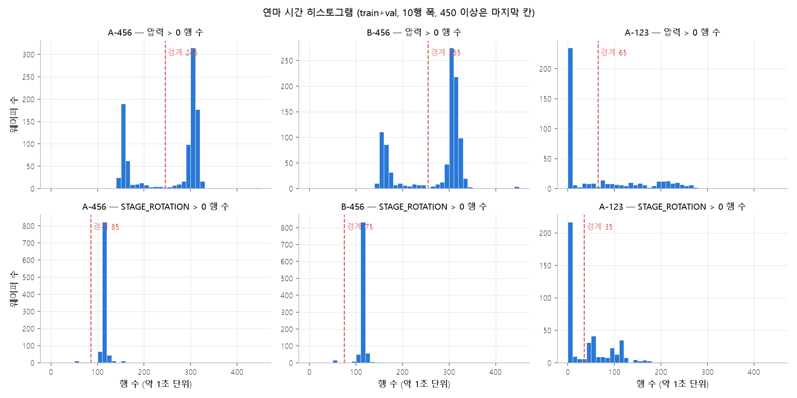
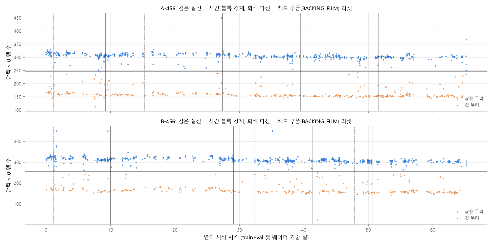

# 456 그룹 연마 시간의 두 무리: 레시피 차이 여부와 SR 군집 표시 변수 판정 (2026-10-28, 김혜연) — v2

> **판정 기준 변경: 시간 블록 조건 → folds 조건.** 변경은 13:08~13:11 사이 팀 결정으로, 이전 결과 생성(13:18)보다 앞선다.
> - 새 기준 (세 조건 모두 만족하면 "표시 변수 포함 가능"): (1) 레시피 차이로 볼 근거가 있음 (무리별로 다른 공정 조건이 함께 달라짐) /
>   (2) 작은 쪽 무리가 그룹 웨이퍼 수의 10% 이상 / (3) `folds_v1.csv`의 모든 fold(5조각 × 5회 = 25개)에서 학습 쪽에 작은 무리가 1장 이상.
> - **조건 (1)(2)는 충족. 조건 (3)은 `data/processed/folds_v1.csv` 커밋 후 확인 예정 → 최종 판정 보류.**
> - `step8_cv_folds_v1.csv`(basic-cmp-ml 브랜치)는 5 × 1, train만이라 사용하지 않음.
> - 이전 기준의 "시간 블록 5개 중 4개 이상" 조건은 판정에 쓰지 않고 참고로만 남긴다 (2절 표).
> - 이 파일은 `2026-10-28_김혜연_recipe_cluster.md`(이전 기준 판정본, 커밋됨)를 고치지 않고 새로 만든 것이다. 3~6절 수치는 같다.

- 스크립트: `src/hyp_recipe_cluster.py` (설정은 `2026-10-28_김혜연_recipe_cluster_wafer.yaml`)
- 산출물: 웨이퍼별 값 `_wafer.csv`, 전체 표 `_tables.md`, 그림 `_hist.png`, `_time.png` (모두 이 폴더)
- 데이터: train·val **센서만** (2,405장, 완전 중복 1,819 / 434행 제거). 집계표·라벨 파일·test·`data/locked/`는 열지 않았다.
- **MRR은 읽지 않았다.** MRR과의 상관이나 무리별 MRR 비교는 하지 않았다 (SR 실행 전).

## 0. 연마 시간 정의 (요청과 다른 점)

요청 원안은 "STAGE_ROTATION > 0 행 수"였지만, 이 정의로는 456 그룹이 150 / 285초로 나뉘지 않는다.
STAGE 회전은 챔버 4·6에서 각 약 57행씩 켜지고, 이건 두 무리가 똑같다(아래 3절 `pos_STAGE_ROTATION` d = 0.0).
150 / 285초 현상은 repro 14·15번과 같은 **압력 6개 중 하나라도 > 0인 행 수**에서 나타난다.
그래서 2026-10-28 확인을 받아 **판정은 압력 기준(press)으로 하고, STAGE_ROTATION 기준(stagerot)은 참고로 함께 보고한다.**
행 간격이 약 1초라 행 수를 초로 읽는다.

## 1. 히스토그램과 경계값

경계 규칙(그룹·정의별로 같은 규칙을 기계적으로 적용): 10행 폭 히스토그램에서 최빈 구간과, 거기서 50행 이상 떨어진 최다 구간을 두 봉우리로 잡고,
그 사이에서 가장 낮은 구간의 중심을 경계로 한다. 골 깊이(골 / 작은 봉우리)가 0.5 이하이면 쌍봉으로 본다.

| 그룹 | 정의 | 봉우리 (행) | 경계 | 골 깊이 | 비고 |
|---|---|---|---|---|---|
| **A-456** | **press** | 155 / 305 | **245** | 0.02 | 뚜렷한 쌍봉 |
| **B-456** | **press** | 155 / 305 | **255** | 0.00 | 뚜렷한 쌍봉 |
| A-456 | stagerot | 55 / 115 | 85 | 0.20 | 115행 단봉 + 55행 근처 19장(2%) |
| B-456 | stagerot | 55 / 115 | 75 | 0.00 | 115행 단봉 + 55행 근처 16장(2%) |
| A-123 (참고) | press | 5 / 75 | 65 | 0.21 | 0행 235장(전체-0 센서) + 넓게 퍼짐 |
| A-123 (참고) | stagerot | 5 / 55 | 35 | 0.15 | 같은 모양 |

- repro 15번의 경계 220초(빈칸 제외 dt 합, 세 split)와 값이 다르지만, 두 경계 사이에 있는 웨이퍼가 적어 무리 구분은 거의 같다.
- stagerot의 55행 근처 소수(2%)는 압력 무리와 **관계없는 별개 현상**이다 (press 짧은 무리 334장 중 stagerot 짧은 쪽은 5장뿐).

## 2. 무리별 웨이퍼 수와 판정

| 그룹 | 정의 | 짧은 / 긴 | 작은 쪽 비율 | 새 조건 (2) ≥ 10% | 블록 1~5의 작은 쪽 수 (참고) | 블록 ≥ 4개 (이전 기준, 참고) | **판정** |
|---|---|---|---|---|---|---|---|
| **A-456** | **press** | 334 / 649 | **34.0%** | 충족 | 56 / 66 / 55 / 70 / 87 | 5 / 5 | **보류 (조건 3 대기)** |
| **B-456** | **press** | 291 / 696 | **29.5%** | 충족 | 44 / 62 / 51 / 50 / 84 | 5 / 5 | **보류 (조건 3 대기)** |
| A-456 | stagerot (참고) | 19 / 964 | 1.9% | 미달 | 5 / 2 / 2 / 4 / 6 | 5 / 5 | 판정 대상 아님 |
| B-456 | stagerot (참고) | 16 / 971 | 1.6% | 미달 | 3 / 1 / 3 / 3 / 6 | 5 / 5 | 판정 대상 아님 |
| A-123 | press (참고) | 271 / 164 | 37.7% | — | 44 / 31 / 28 / 29 / 32 | — | 판정 대상 아님 |

- split별 짧은 무리 비율: A-456 train 33% / val 38%, B-456 train 30% / val 26%.
- 시간 블록 = 그룹별 train+val 웨이퍼를 시작 시각 순으로 정렬해 같은 수로 5등분 (`np.array_split`). 블록 5에서 짧은 무리 비율이 조금 높다(A 44%, B 43%, 나머지 블록 22~36%).

## 3. 무리별 공정 조건 (press 기준, 평균 ± 표준편차, d = 표준화 평균차, |d| ≥ 0.8을 "큼"으로 표시)

**웨이퍼 전체**에서 보면:

| 항목 | A-456 짧은 / 긴 | d | B-456 짧은 / 긴 | d |
|---|---|---|---|---|
| 리테이너 725 단계 체류 (행) | 17.0 ± 3.3 / 32.1 ± 4.5 | **3.8** | 18.6 ± 4.3 / 34.8 ± 8.4 | **2.4** |
| 리테이너 1,450 단계 체류 | 128 ± 16 / 243 ± 16 | **7.1** | 133 ± 21 / 252 ± 73 | **2.2** |
| 리테이너 7,135 단계 체류 | 14.0 ± 2.5 / 24.5 ± 4.7 | **2.8** | 13.9 ± 2.5 / 23.0 ± 7.8 | **1.6** |
| 슬러리 A·B > 0 행 수 | 203 ± 39 / 341 ± 22 | **4.3** | 211 ± 44 / 353 ± 118 | **1.6** |
| 슬러리 C > 0 행 수 | 151 ± 21 / 271 ± 19 | **6.1** | 157 ± 24 / 283 ± 87 | **2.0** |
| 챔버 5 압력 > 0 행 수 | 4.3 ± 14 / 78.5 ± 12 | **5.7** | 4.5 ± 15 / 79.2 ± 12 | **5.4** |
| 챔버 6 압력 > 0 행 수 | 3.3 ± 12 / 70.7 ± 14 | **5.2** | 4.9 ± 16 / 72.2 ± 65 | **1.4** |
| 에어백 4개·가압 챔버 (압력 > 0 행 평균) | 차이 1~3% | 0.1~0.4 | 차이 1~4% | 0.4~0.6 |
| 리테이너 링 (압력 > 0 행 평균) | 1,841 / 1,821 | −0.25 | 1,819 / 1,783 | −0.40 |
| 슬러리 A·C 유량 (압력 > 0 행 평균) | 같음 | −0.1~0.4 | 같음 | 0.0~0.5 |
| 헤드·웨이퍼·스테이지 회전 (켜진 행 수, 켜진 값) | 같음 | −0.35~0.3 | 같음 | −0.07~0.23 |
| 챔버 4·5·6 체류 행 수, 전체 행 수 | 같음 | −0.04~0.13 | 같음 | 0.06~0.11 |

**챔버 4만** 보면 (짧은 무리는 챔버 4에서만 압력이 걸리므로, 설정값은 챔버 4끼리 비교해야 공정하다):

| 항목 (챔버 4, 압력 > 0 행) | A-456 d | B-456 d |
|---|---|---|
| 리테이너 725 / 1,450 / 7,135 단계 체류 | −0.10 / 0.14 / 0.10 | 0.07 / 0.07 / 0.13 |
| 에어백 4개, 가압 챔버, 리테이너 링 평균 | −0.14 ~ 0.15 | −0.03 ~ 0.20 |
| 슬러리 A·C 평균 | −0.03 / 0.05 | 0.07 / −0.08 |
| 압력 > 0 행 수 | 0.12 | 0.08 |

- SLURRY_B 유량은 d가 −5.7 ~ −6.6으로 계산되지만 두 무리 모두 0.91로 평균이 같고 표준편차가 0에 가까워 생긴 인공값이다. 차이로 보지 않는다.
- **"큼"으로 잡힌 항목은 모두 챔버 5·6에서 압력·슬러리가 켜졌는지 여부 하나로 설명된다.** 리테이너 단계 시간이 약 절반인 것도 챔버 5·6 몫이 빠진 결과이고, 챔버 4만 보면 단계 구성·압력 설정값·유량이 같다(|d| ≤ 0.2).
- 압력 > 0 행의 웨이퍼 전체 평균이 0.4~0.6 정도 다른 것은 (B-456 에어백) 짧은 무리 값이 챔버 4만의 평균이기 때문이다. 챔버 4끼리는 차이가 없다.

## 4. 시간 패턴

| | A-456 | B-456 |
|---|---|---|
| 연(run) 수 관측 / 무작위 기대 | 461 / 442 (z = +1.35, p = 0.18) | 391 / 411 (z = −1.56, p = 0.12) |
| 짧은 무리 연 길이 중앙값 (최대) | 1 (7) | 1 (5) |
| 긴 무리 연 길이 중앙값 (최대) | 2 (17) | 3 (19) |

- **번갈아 나온다.** 짧은 무리는 대부분 한 장씩 끼어들고, 연 수가 무작위 기대와 다르지 않다. 특정 기간에 몰리지 않고 65일 내내 있다.
- 블록 5(51~65일)에 짧은 무리가 조금 많다(2절).

## 5. 교차표

| | 짧은 | 긴 |
|---|---|---|
| 스테이지 A (A-456) | 334 | 649 |
| 스테이지 B (B-456) | 291 | 696 |

- 거친 챔버 구성: 456 그룹 1,970장 중 1,967장이 4·5·6을 모두 거쳤다. 불완전 3장(챔버 4만 2장, 4·6만 1장)은 짧은 2 / 긴 1이라 무리를 만들지 않는다.
- 챔버별 중앙값: 체류 행 수는 두 무리가 같고(챔버 4 185~190, 5 84~85, 6 71~72), 압력 > 0 행 수만 챔버 5·6에서 0 대 72~79로 다르다.
- 시간 블록별 수는 2절 표.

## 6. 소모품 리셋과 무리 전환

리셋은 `aggregate.py`와 같은 규칙(스테이지별 웨이퍼 시작값, 범위의 20% 이상 감소)을 train·val만으로 다시 적용했다.
횟수: POLISH_TABLE A 99 / B 87, DRESSER 3 / 3, BACKING_FILM·MEMBRANE·PSHEET 각 5 / 5 (세 split 합산 100 / 87 등과 거의 같다).

| 그룹 | 카운터 | 리셋 수 | 리셋 직후 전환율 | 평소 전환율 | 이항 p | 짧은 무리 비율 (전 10장 → 후 10장) |
|---|---|---|---|---|---|---|
| A-456 | POLISH_TABLE | 99 | 0.59 | 0.47 | 0.02 | 0.36 → 0.33 |
| A-456 | 헤드 3종 | 5 | 0.40 | 0.47 | 1.0 | 0.30 → 0.28 |
| A-456 | DRESSER | 3 | 0.67 | 0.47 | 0.60 | 0.50 → 0.37 |
| B-456 | POLISH_TABLE | 87 | 0.43 | 0.40 | 0.59 | 0.32 → 0.31 |
| B-456 | 헤드 3종 | 5 | 0.60 | 0.40 | 0.39 | 0.18 → 0.12 |
| B-456 | DRESSER | 3 | 0.00 | 0.40 | 0.28 | 0.43 → 0.27 |

- **겹치지 않는다.** 리셋 전후로 짧은 무리 비율이 달라지지 않는다. A-456 POLISH_TABLE의 전환율만 p = 0.02인데, 같은 비교 10개 중 하나이고(본페로니 기준 0.005) B-456에서는 재현되지 않는다.

## 7. 결론

**SR 군집 표시 변수 판정 (press 기준, 2026-10-28 13:08~13:11 변경된 팀 기준)**
- A-456: (1) 충족 (아래 근거) / (2) 충족 (작은 쪽 34.0%) / (3) 확인 예정 → **보류**
- B-456: (1) 충족 (아래 근거) / (2) 충족 (작은 쪽 29.5%) / (3) 확인 예정 → **보류**
- 조건 (3)은 `data/processed/folds_v1.csv`(train+val, 5조각 × 5회, WAFER_ID 묶음, 그룹 층화, 시드 42~46) 커밋 후 fold별 학습 쪽 무리 수 표로 확인한다.
- 참고: 이전 기준의 시간 블록 조건은 두 그룹 모두 5 / 5블록이었다. STAGE_ROTATION 기준 정의는 두 그룹 모두 작은 쪽이 1.6~1.9%로 10% 미달이며, 이 소수 무리는 150 / 285초 현상과 다른 것이다.

**레시피 차이로 볼 근거 (판정 조건 아님, 해석용)**
- 함께 달라지는 조건은 **챔버 5·6에서 압력과 슬러리(A·B·C)가 켜지느냐** 하나다. 그 결과로 리테이너 단계별 체류와 슬러리 공급 시간이 약 절반이 된다.
- 챔버 4의 압력 설정값·단계 구성·유량, 세 회전, 챔버별 체류 시간은 두 무리가 같다.
- 무리는 스테이지 A·B 모두에 약 1 : 2로 있고, 웨이퍼 단위로 무작위하게 번갈아 나오며, 소모품 교체와 무관하다.
- 따라서 "같은 레시피에서 설정값만 다른 것"이 아니라 **"챔버 5·6 연마 단계를 하느냐 마느냐"라는 이진 차이**다. 웨이퍼마다 정해지는 숨은 레시피(1단계 / 3단계 연마)로 볼 수 있다.
  다만 회전과 체류는 정상인 채 챔버 5·6의 압력·슬러리 채널만 빠진 **기록 누락**과는 센서만으로 구분되지 않는다 (repro 15-2의 해석 ①·②와 같은 상태).
