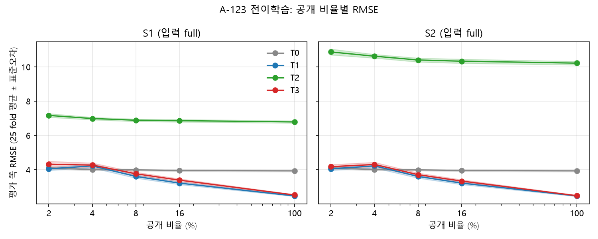
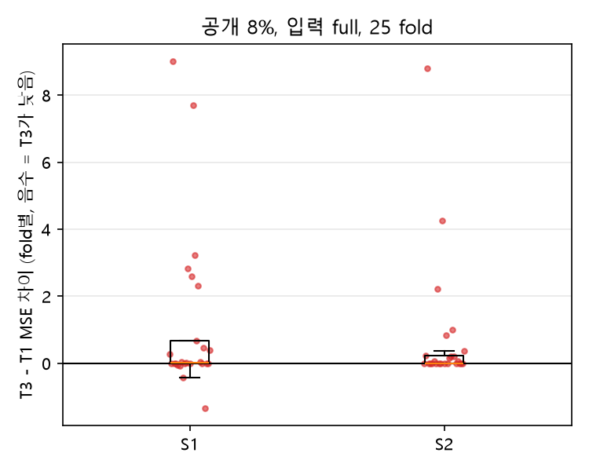
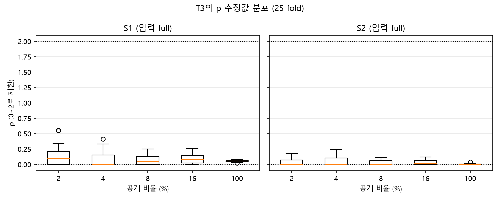
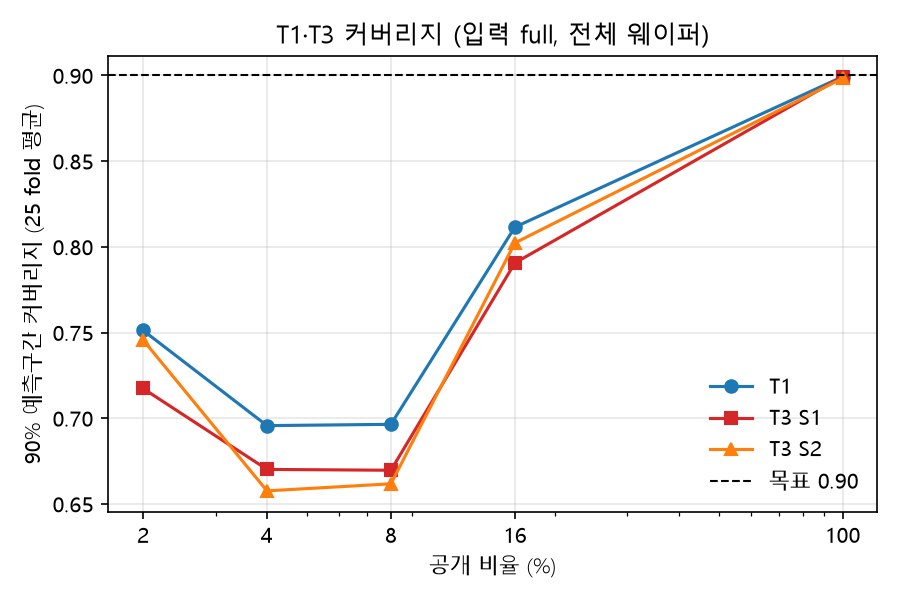

# A-123 전이학습 주 평가 정리 (FV1)

- 입력: `results/2026-11-01_김혜연_FV1_a123_transfer_folds.csv`, `2026-11-01_김혜연_FV1_a123_transfer_stats.csv`, `2026-11-01_김혜연_FV1_a123_transfer_judgment.csv`, `2026-11-01_김혜연_FV1_a123_transfer_rho.csv` (PR #25)
- 실행 커밋 9947b4c, xgboost 3.2.0, f_456 n_jobs 2. 숫자는 모두 위 csv에서 계산 (`src/plot_a123_transfer.py`)
- 범위: folds_v1 25 fold, 고정주기 공개, 소스 S1(A-456)·S2(A-456+B-456), f_456 입력 full·usage, T0~T3.
  전진 검증(보조 판정), 무작위 공개, δ XGBoost, 라벨 피처 실험은 하지 않았다.
- 표기: 평균 ± 표준편차(25 fold, ddof=1). T0·T1은 소스·입력과 무관해 S1·S2 칸 값이 같다.

## 0. 판정 (preregistration.md 5.5절, 공개 8%, 입력 full)

| 판정 | 소스 | 평균 MSE 차이 | p (full) | p (revealed) | 통과 | 최종 판정 |
|---|---|---|---|---|---|---|
| 주 판정 (T3-T1) | S1 | 1.106 | 0.409 | 0.800 | ✗ | 효과 없음 (기본값 T1 유지) |
| 주 판정 (T3-T1) | S2 | 0.737 | 0.484 | 0.830 | ✗ |  |
| 2차 판정 (T3-T2) | S1 | -33.202 | 8e-10 | 0.007 | ✓ | 효과 있음 |
| 2차 판정 (T3-T2) | S2 | -94.595 | 1.8e-13 | 0.00016 | ✓ |  |

- **주 판정 (T3 대 T1): 효과 없음 (기본값 T1 유지).** S1·S2 모두 평균 MSE 차이 ≥ 0, p ≥ 0.05.
- **2차 판정 (T3 대 T2): 효과 있음.** S1·S2 모두 평균 차이 < 0, p < 0.05 (δ GP의 추가 효과).
- p (revealed)는 병기만 하고 판정에 쓰지 않는다 (5.5).
- 보조 판정(전진 검증)은 아직 실행하지 않았다 (5.7-17 일정상 11/1 이후).
- usage 입력은 보고만 한다 (판정 대상 아님). S1 대 S2 차이는 "같은 스테이지 데이터가 더 비슷한가"라는 관찰로만 본다 (5.0 해석 제한).
- 한계 (5.5): A-123은 MRR 변동이 작다 (변동계수 0.027). T0 대비 개선폭은 2절.
- 90% 예측구간은 WhiteKernel 잡음만 포함하고 f_456·ρ·b의 불확실성은 무시한다 (5.7-10).

### fold당 실제 공개 장수 (5.3)

| 비율(%) | 전체 (최소~최대) | 센서 정상 (최소~최대) | δ 입력 개수 (최소~최대) | 등방성 커널 fold |
|---|---|---|---|---|
| 2 | 7.0 (7~7) | 2.8 (1~5) | 2~2 | 25 |
| 4 | 14.0 (14~14) | 5.2 (1~9) | 2~2 | 0 |
| 8 | 28.0 (28~28) | 10.2 (5~16) | 4~4 | 0 |
| 16 | 55.0 (55~55) | 21.0 (12~31) | 6~6 | 0 |
| 100 | 344.8 (344~345) | 132.8 (123~141) | 6~6 | 0 |

### 참고: 비율별 T3 대 T1 (2·4·16·100%는 경향만, 검정은 참고 — 5.5)

| 비율(%) | 입력 | 소스 | 평균 MSE 차이 | 차이 SD | 앞 모델이 낮은 fold | p (full) | p (revealed) |
|---|---|---|---|---|---|---|---|
| 2 | full | S1 | 2.798 | 5.997 | 8/25 | 0.395 | 0.895 |
| 2 | full | S2 | 1.228 | 3.124 | 6/25 | 0.472 | 0.912 |
| 2 | usage | S1 | 2.517 | 14.594 | 14/25 | 0.752 | 0.961 |
| 2 | usage | S2 | 0.607 | 5.445 | 15/25 | 0.838 | 0.975 |
| 4 | full | S1 | 0.410 | 1.475 | 11/25 | 0.611 | 0.912 |
| 4 | full | S2 | 0.741 | 1.896 | 10/25 | 0.475 | 0.877 |
| 4 | usage | S1 | -2.299 | 4.014 | 19/25 | 0.298 | 0.820 |
| 4 | usage | S2 | -1.768 | 3.172 | 19/25 | 0.311 | 0.825 |
| 8 | full | S1 | 1.106 | 2.443 | 8/25 | 0.409 | 0.800 |
| 8 | full | S2 | 0.737 | 1.925 | 7/25 | 0.484 | 0.830 |
| 8 | usage | S1 | -0.363 | 1.827 | 18/25 | 0.716 | 0.911 |
| 8 | usage | S2 | 0.169 | 2.054 | 14/25 | 0.880 | 0.963 |
| 16 | full | S1 | 1.154 | 1.762 | 4/25 | 0.236 | 0.610 |
| 16 | full | S2 | 0.782 | 1.366 | 10/25 | 0.299 | 0.656 |
| 16 | usage | S1 | 0.368 | 2.431 | 10/25 | 0.781 | 0.906 |
| 16 | usage | S2 | 0.321 | 1.955 | 7/25 | 0.763 | 0.898 |
| 100 | full | S1 | 0.278 | 0.216 | 0/25 | 0.025 | 0.025 |
| 100 | full | S2 | 0.076 | 0.202 | 8/25 | 0.490 | 0.490 |
| 100 | usage | S1 | -0.137 | 0.388 | 13/25 | 0.518 | 0.518 |
| 100 | usage | S2 | -0.045 | 0.414 | 13/25 | 0.841 | 0.841 |

## 1. 비율 × 모델 RMSE·MAE·MSE (전체 웨이퍼)

### 입력 full

| 비율(%) | 모델 | S1 RMSE | S1 MAE | S1 MSE | S2 RMSE | S2 MAE | S2 MSE |
|---|---|---|---|---|---|---|---|
| 2 | T0 | 4.103 ± 0.371 | 3.258 ± 0.310 | 16.96 ± 3.08 | 4.103 ± 0.371 | 3.258 ± 0.310 | 16.96 ± 3.08 |
| 2 | T1 | 4.047 ± 0.453 | 3.207 ± 0.379 | 16.58 ± 3.82 | 4.047 ± 0.453 | 3.207 ± 0.379 | 16.58 ± 3.82 |
| 2 | T2 | 7.167 ± 0.553 | 6.004 ± 0.455 | 51.66 ± 7.97 | 10.872 ± 0.866 | 9.284 ± 0.845 | 118.93 ± 19.51 |
| 2 | T3 | 4.319 ± 0.868 | 3.450 ± 0.718 | 19.37 ± 8.93 | 4.173 ± 0.638 | 3.316 ± 0.525 | 17.80 ± 6.18 |
| 4 | T0 | 4.004 ± 0.293 | 3.154 ± 0.214 | 16.12 ± 2.35 | 4.004 ± 0.293 | 3.154 ± 0.214 | 16.12 ± 2.35 |
| 4 | T1 | 4.220 ± 0.617 | 3.297 ± 0.474 | 18.17 ± 5.50 | 4.220 ± 0.617 | 3.297 ± 0.474 | 18.17 ± 5.50 |
| 4 | T2 | 6.985 ± 0.372 | 5.908 ± 0.351 | 48.92 ± 5.12 | 10.625 ± 0.549 | 9.260 ± 0.711 | 113.18 ± 11.76 |
| 4 | T3 | 4.265 ± 0.639 | 3.348 ± 0.493 | 18.58 ± 5.67 | 4.301 ± 0.660 | 3.387 ± 0.513 | 18.91 ± 5.87 |
| 8 | T0 | 3.985 ± 0.250 | 3.137 ± 0.196 | 15.94 ± 1.96 | 3.985 ± 0.250 | 3.137 ± 0.196 | 15.94 ± 1.96 |
| 8 | T1 | 3.605 ± 0.503 | 2.814 ± 0.405 | 13.24 ± 3.88 | 3.605 ± 0.503 | 2.814 ± 0.405 | 13.24 ± 3.88 |
| 8 | T2 | 6.886 ± 0.364 | 5.827 ± 0.361 | 47.55 ± 5.14 | 10.404 ± 0.576 | 9.235 ± 0.601 | 108.57 ± 12.24 |
| 8 | T3 | 3.760 ± 0.469 | 2.944 ± 0.361 | 14.34 ± 3.66 | 3.705 ± 0.507 | 2.893 ± 0.394 | 13.98 ± 3.92 |
| 16 | T0 | 3.947 ± 0.269 | 3.114 ± 0.213 | 15.65 ± 2.11 | 3.947 ± 0.269 | 3.114 ± 0.213 | 15.65 ± 2.11 |
| 16 | T1 | 3.212 ± 0.412 | 2.531 ± 0.350 | 10.48 ± 2.91 | 3.212 ± 0.412 | 2.531 ± 0.350 | 10.48 ± 2.91 |
| 16 | T2 | 6.859 ± 0.377 | 5.827 ± 0.389 | 47.19 ± 5.24 | 10.334 ± 0.609 | 9.160 ± 0.646 | 107.14 ± 12.95 |
| 16 | T3 | 3.387 ± 0.411 | 2.665 ± 0.336 | 11.63 ± 2.90 | 3.333 ± 0.398 | 2.632 ± 0.328 | 11.26 ± 2.79 |
| 100 | T0 | 3.929 ± 0.254 | 3.100 ± 0.191 | 15.50 ± 1.98 | 3.929 ± 0.254 | 3.100 ± 0.191 | 15.50 ± 1.98 |
| 100 | T1 | 2.464 ± 0.140 | 1.866 ± 0.129 | 6.09 ± 0.69 | 2.464 ± 0.140 | 1.866 ± 0.129 | 6.09 ± 0.69 |
| 100 | T2 | 6.787 ± 0.341 | 5.775 ± 0.352 | 46.17 ± 4.65 | 10.221 ± 0.521 | 9.130 ± 0.526 | 104.73 ± 10.87 |
| 100 | T3 | 2.519 ± 0.150 | 1.912 ± 0.133 | 6.37 ± 0.75 | 2.479 ± 0.153 | 1.879 ± 0.137 | 6.17 ± 0.76 |

### 입력 usage (보고만)

| 비율(%) | 모델 | S1 RMSE | S1 MAE | S1 MSE | S2 RMSE | S2 MAE | S2 MSE |
|---|---|---|---|---|---|---|---|
| 2 | T0 | 4.103 ± 0.371 | 3.258 ± 0.310 | 16.96 ± 3.08 | 4.103 ± 0.371 | 3.258 ± 0.310 | 16.96 ± 3.08 |
| 2 | T1 | 4.047 ± 0.453 | 3.207 ± 0.379 | 16.58 ± 3.82 | 4.047 ± 0.453 | 3.207 ± 0.379 | 16.58 ± 3.82 |
| 2 | T2 | 5.720 ± 0.358 | 4.728 ± 0.310 | 32.84 ± 4.13 | 7.132 ± 0.525 | 5.967 ± 0.494 | 51.13 ± 7.73 |
| 2 | T3 | 4.191 ± 1.262 | 3.312 ± 1.129 | 19.09 ± 16.90 | 4.078 ± 0.757 | 3.210 ± 0.644 | 17.18 ± 7.82 |
| 4 | T0 | 4.004 ± 0.293 | 3.154 ± 0.214 | 16.12 ± 2.35 | 4.004 ± 0.293 | 3.154 ± 0.214 | 16.12 ± 2.35 |
| 4 | T1 | 4.220 ± 0.617 | 3.297 ± 0.474 | 18.17 ± 5.50 | 4.220 ± 0.617 | 3.297 ± 0.474 | 18.17 ± 5.50 |
| 4 | T2 | 5.565 ± 0.274 | 4.610 ± 0.248 | 31.04 ± 3.05 | 6.971 ± 0.325 | 5.824 ± 0.276 | 48.70 ± 4.56 |
| 4 | T3 | 3.954 ± 0.497 | 3.103 ± 0.410 | 15.87 ± 4.17 | 4.024 ± 0.469 | 3.153 ± 0.417 | 16.41 ± 3.95 |
| 8 | T0 | 3.985 ± 0.250 | 3.137 ± 0.196 | 15.94 ± 1.96 | 3.985 ± 0.250 | 3.137 ± 0.196 | 15.94 ± 1.96 |
| 8 | T1 | 3.605 ± 0.503 | 2.814 ± 0.405 | 13.24 ± 3.88 | 3.605 ± 0.503 | 2.814 ± 0.405 | 13.24 ± 3.88 |
| 8 | T2 | 5.561 ± 0.206 | 4.602 ± 0.216 | 30.97 ± 2.29 | 6.948 ± 0.298 | 5.829 ± 0.273 | 48.36 ± 4.16 |
| 8 | T3 | 3.560 ± 0.461 | 2.742 ± 0.346 | 12.88 ± 3.49 | 3.622 ± 0.546 | 2.781 ± 0.401 | 13.41 ± 4.28 |
| 16 | T0 | 3.947 ± 0.269 | 3.114 ± 0.213 | 15.65 ± 2.11 | 3.947 ± 0.269 | 3.114 ± 0.213 | 15.65 ± 2.11 |
| 16 | T1 | 3.212 ± 0.412 | 2.531 ± 0.350 | 10.48 ± 2.91 | 3.212 ± 0.412 | 2.531 ± 0.350 | 10.48 ± 2.91 |
| 16 | T2 | 5.537 ± 0.241 | 4.595 ± 0.242 | 30.72 ± 2.67 | 6.934 ± 0.304 | 5.814 ± 0.295 | 48.17 ± 4.25 |
| 16 | T3 | 3.271 ± 0.390 | 2.538 ± 0.322 | 10.85 ± 2.61 | 3.269 ± 0.347 | 2.527 ± 0.279 | 10.80 ± 2.35 |
| 100 | T0 | 3.929 ± 0.254 | 3.100 ± 0.191 | 15.50 ± 1.98 | 3.929 ± 0.254 | 3.100 ± 0.191 | 15.50 ± 1.98 |
| 100 | T1 | 2.464 ± 0.140 | 1.866 ± 0.129 | 6.09 ± 0.69 | 2.464 ± 0.140 | 1.866 ± 0.129 | 6.09 ± 0.69 |
| 100 | T2 | 5.515 ± 0.245 | 4.569 ± 0.244 | 30.47 ± 2.72 | 6.911 ± 0.305 | 5.784 ± 0.300 | 47.85 ± 4.24 |
| 100 | T3 | 2.435 ± 0.154 | 1.842 ± 0.131 | 5.95 ± 0.73 | 2.454 ± 0.154 | 1.866 ± 0.134 | 6.05 ± 0.74 |

## 2. T0 대비 RMSE 개선폭 (%)

(T0 RMSE − 모델 RMSE) / T0 RMSE × 100, 각 RMSE는 25 fold 평균. 음수 = T0보다 큼.

| 비율(%) | T0 RMSE | T1 | T2 S1 full | T3 S1 full | T2 S2 full | T3 S2 full | T2 S1 usage | T3 S1 usage | T2 S2 usage | T3 S2 usage |
|---|---|---|---|---|---|---|---|---|---|---|
| 2 | 4.103 | 1.4 | -74.7 | -5.3 | -165.0 | -1.7 | -39.4 | -2.1 | -73.8 | 0.6 |
| 4 | 4.004 | -5.4 | -74.4 | -6.5 | -165.4 | -7.4 | -39.0 | 1.2 | -74.1 | -0.5 |
| 8 | 3.985 | 9.5 | -72.8 | 5.7 | -161.1 | 7.0 | -39.6 | 10.7 | -74.4 | 9.1 |
| 16 | 3.947 | 18.6 | -73.8 | 14.2 | -161.8 | 15.6 | -40.3 | 17.1 | -75.7 | 17.2 |
| 100 | 3.929 | 37.3 | -72.7 | 35.9 | -160.1 | 36.9 | -40.4 | 38.0 | -75.9 | 37.5 |

## 3. T2 대 T1 (보고만, 공개 8%)

평균 MSE 차이 = T2 − T1. "앞 모델이 낮은 fold" = T2가 낮은 fold 수.

| 비율(%) | 입력 | 소스 | 평균 MSE 차이 | 차이 SD | 앞 모델이 낮은 fold | p (full) | p (revealed) |
|---|---|---|---|---|---|---|---|
| 8 | full | S1 | 34.308 | 6.492 | 0/25 | 7.1e-10 | 0.006 |
| 8 | full | S2 | 95.332 | 12.766 | 0/25 | 5.9e-13 | 0.0003 |
| 8 | usage | S1 | 17.727 | 4.634 | 0/25 | 2.4e-07 | 0.040 |
| 8 | usage | S2 | 35.120 | 5.434 | 0/25 | 1.2e-11 | 0.001 |

## 4. 90% 예측구간 커버리지 (목표 0.90, 전체 웨이퍼)

| 비율(%) | T1 | T3 S1 full | T3 S2 full | T3 S1 usage | T3 S2 usage |
|---|---|---|---|---|---|
| 2 | 0.751 ± 0.167 | 0.717 ± 0.174 | 0.746 ± 0.143 | 0.669 ± 0.198 | 0.706 ± 0.182 |
| 4 | 0.696 ± 0.156 | 0.670 ± 0.171 | 0.658 ± 0.191 | 0.699 ± 0.129 | 0.691 ± 0.134 |
| 8 | 0.696 ± 0.147 | 0.670 ± 0.141 | 0.662 ± 0.155 | 0.646 ± 0.195 | 0.660 ± 0.140 |
| 16 | 0.811 ± 0.136 | 0.791 ± 0.115 | 0.802 ± 0.114 | 0.750 ± 0.146 | 0.779 ± 0.124 |
| 100 | 0.899 ± 0.026 | 0.899 ± 0.027 | 0.898 ± 0.026 | 0.907 ± 0.027 | 0.909 ± 0.030 |

## 5. ρ 분포 (T3, 25 fold)

ρ는 0~2로 제한 (5.4). "ρ=0 fold"·"ρ=2 fold"는 경계에 붙은 fold 수.

| 비율(%) | 소스 | 입력 | 평균 | SD | 범위 | ρ=0 fold | ρ=2 fold |
|---|---|---|---|---|---|---|---|
| 2 | S1 | full | 0.134 | 0.166 | 0.000 ~ 0.553 | 11 | 0 |
| 2 | S1 | usage | 0.306 | 0.188 | 0.000 ~ 0.606 | 2 | 0 |
| 2 | S2 | full | 0.041 | 0.056 | 0.000 ~ 0.173 | 13 | 0 |
| 2 | S2 | usage | 0.215 | 0.136 | 0.000 ~ 0.487 | 3 | 0 |
| 4 | S1 | full | 0.092 | 0.124 | 0.000 ~ 0.414 | 13 | 0 |
| 4 | S1 | usage | 0.295 | 0.154 | 0.000 ~ 0.600 | 1 | 0 |
| 4 | S2 | full | 0.055 | 0.074 | 0.000 ~ 0.247 | 13 | 0 |
| 4 | S2 | usage | 0.217 | 0.125 | 0.000 ~ 0.517 | 2 | 0 |
| 8 | S1 | full | 0.070 | 0.076 | 0.000 ~ 0.252 | 6 | 0 |
| 8 | S1 | usage | 0.284 | 0.077 | 0.126 ~ 0.440 | 0 | 0 |
| 8 | S2 | full | 0.030 | 0.037 | 0.000 ~ 0.111 | 13 | 0 |
| 8 | S2 | usage | 0.210 | 0.075 | 0.056 ~ 0.360 | 0 | 0 |
| 16 | S1 | full | 0.091 | 0.073 | 0.000 ~ 0.263 | 1 | 0 |
| 16 | S1 | usage | 0.316 | 0.056 | 0.177 ~ 0.398 | 0 | 0 |
| 16 | S2 | full | 0.030 | 0.038 | 0.000 ~ 0.118 | 12 | 0 |
| 16 | S2 | usage | 0.235 | 0.044 | 0.128 ~ 0.328 | 0 | 0 |
| 100 | S1 | full | 0.054 | 0.014 | 0.024 ~ 0.081 | 0 | 0 |
| 100 | S1 | usage | 0.291 | 0.013 | 0.255 ~ 0.313 | 0 | 0 |
| 100 | S2 | full | 0.004 | 0.008 | 0.000 ~ 0.037 | 11 | 0 |
| 100 | S2 | usage | 0.217 | 0.011 | 0.190 ~ 0.233 | 0 | 0 |

## 6. 웨이퍼 분해 (공개 8%, 입력 full, RMSE)

분해 결과는 보고만 (5.7-16). 전체-0 = A-123 전체-0 센서 웨이퍼 (`allzero`).

| 웨이퍼 | fold 수 | fold당 평가 장수 | T1 | T3 S1 | T3 S2 |
|---|---|---|---|---|---|
| 전체 | 25 | 86.2 | 3.605 ± 0.503 | 3.760 ± 0.469 | 3.705 ± 0.507 |
| 센서 정상 | 25 | 33.2 | 3.421 ± 0.688 | 3.610 ± 0.626 | 3.556 ± 0.646 |
| 전체-0 | 25 | 53.0 | 3.699 ± 0.470 | 3.835 ± 0.478 | 3.781 ± 0.521 |

## 7. P1_on 포함/제외 fold (공개 8%, 5.7-13)

T3−T1 MSE 차이 (fold별, 음수 = T3가 낮음). δ 입력은 소스·입력과 무관하게 fold마다 같다.

| 입력 | 소스 | P1_on | fold 수 | T3−T1 MSE 차이 평균 | SD | T3가 낮은 fold |
|---|---|---|---|---|---|---|
| full | S1 | 포함 | 0 | — | — | 0/0 |
| full | S1 | 제외 | 25 | 1.106 | 2.443 | 8/25 |
| full | S2 | 포함 | 0 | — | — | 0/0 |
| full | S2 | 제외 | 25 | 0.737 | 1.925 | 7/25 |
| usage | S1 | 포함 | 0 | — | — | 0/0 |
| usage | S1 | 제외 | 25 | -0.363 | 1.827 | 18/25 |
| usage | S2 | 포함 | 0 | — | — | 0/0 |
| usage | S2 | 제외 | 25 | 0.169 | 2.054 | 14/25 |

- 8%에서 센서 정상 공개가 10장 이상인 fold는 16/25이지만, 단일 변수가 4개 들어간 뒤 상한 5개 중
  자리가 1개만 남아 `P1_on`·`allzero` 쌍은 어느 fold에도 들어가지 않았다 (5.7-8). 포함/제외 비교는 할 수 없다.

## 8. GP 경고

T1은 fold당 1회 학습 (비율당 25회). T3은 fold × 소스 × 입력마다 1회 (칸마다 25회). 값 = 경고 건수 (경고가 난 fold 수/25).

| 비율(%) | T1 경고 건수 | T1 경고 fold | T3 S1 full | T3 S2 full | T3 S1 usage | T3 S2 usage |
|---|---|---|---|---|---|---|
| 2 | 8 | 8/25 | 10 (10/25) | 10 (9/25) | 13 (12/25) | 12 (11/25) |
| 4 | 18 | 16/25 | 20 (18/25) | 20 (17/25) | 23 (19/25) | 25 (20/25) |
| 8 | 41 | 22/25 | 37 (24/25) | 40 (23/25) | 51 (25/25) | 45 (24/25) |
| 16 | 62 | 23/25 | 63 (24/25) | 57 (23/25) | 61 (24/25) | 64 (25/25) |
| 100 | 61 | 24/25 | 67 (24/25) | 63 (25/25) | 62 (24/25) | 71 (25/25) |

- 경고 종류(메시지)와 어느 하이퍼파라미터가 어느 쪽 경계에 붙었는지는 **결과 csv에 저장돼 있지 않아 이 정리에서 셀 수 없다.**
  csv에는 `gp_warn_t1`·`gp_warn_t3`(ConvergenceWarning·UserWarning·RuntimeWarning 합계)만 있다.
- 경고가 나도 결과는 그대로 쓴다 (5.7-15).

## 9. δ 입력 (공개 8%, fold별 실제 입력)

공개 28장 → 상한 max(2, 내림(28/5)) = 5개.

| 변수 | 들어간 fold 수 |
|---|---|
| t_start | 25/25 |
| mean_POLISH_TABLE_s1 | 25/25 |
| mean_DRESSER_s1 | 25/25 |
| mean_MEMBRANE_s1 | 25/25 |

| δ 입력 조합 | fold 수 |
|---|---|
| t_start, mean_POLISH_TABLE_s1, mean_DRESSER_s1, mean_MEMBRANE_s1 | 25 |

## 그림

- 그림 1: 공개 비율 대 RMSE (T0~T3, 25 fold 표준오차 띠, 입력 full) 
- 그림 2: 8% fold별 T3−T1 MSE 차이 (입력 full) 
- 그림 3: ρ 분포 (입력 full, 점선 0·2) 
- 그림 4: T1·T3 커버리지 (입력 full, 기준선 0.90) 
